```{=latex}
\begin{titlepage}
\centering
\thispagestyle{empty}
\includegraphics[width=3cm]{imagens/unb/unb.png}\\[0.8cm]
{\large UNIVERSIDADE DE BRASÍLIA\\}
{\large INSTITUTO DE CIÊNCIAS EXATAS\\}
{\large DEPARTAMENTO DE ESTATÍSTICA\\}
{\large TÉCNICAS DE AMOSTRAGEM\\[2.5cm]}
{\Large\bfseries Pesquisa Eleitoral na UnB: Estimação da Intenção de Voto por Amostragem\\[0.4cm]}
{\large
Caroline Hernandes Amancio\\
Helio Ferreira de Carvalho\\
Karine Alves de Freitas Leite\\
Marcos Well Neres Silva Pereira\\
}
\vfill
{\large Brasília -- DF}\\
{\large 2026}
\end{titlepage}

\renewcommand{\contentsname}{Sumário}
\tableofcontents
\newpage


```

# Resumo

As pesquisas de opinião pública ocupam papel central nos processos democráticos, funcionando como mediadoras entre a vontade dos cidadãos e as elites políticas. Este trabalho tem como objetivo estimar a proporção de intenção de voto para os cargos de Presidente e Governador do Distrito Federal, a partir de uma amostra de 400 eleitores abordados presencialmente nos pavilhoes Anísio Teixeira e João Calmon, por meio de amostragem sistemática (com intervalo $K$ definido por sorteio individual de cada entrevistador — Seção 2) tratada como equivalente à Amostragem Aleatória Simples sem reposição. O tamanho de amostra (n=400) é justificado a partir da fórmula de dimensionamento amostral para uma margem de erro de 5 pontos percentuais. As estimativas pontuais, variâncias e intervalos de confiança foram obtidos via `PROC SURVEYFREQ` no software SAS, e o efeito da não-resposta (34% — respondentes que deixaram a pergunta de voto em branco) sobre a margem de erro foi quantificado. O candidato Luiz Inácio Lula da Silva lidera a intenção de voto para Presidente (61,36%, IC 95%: [55,45%; 67,28%]) e Leandro Grass para Governador (56,06%, IC 95%: [50,03%; 62,09%]). A análise por subgrupos (turno, faixa etária e faixa de renda) indicou diferença estatisticamente significativa na intenção de voto principalmente em função da faixa etária (p<0,0001 para os dois cargos); a associação com turno de coleta só foi significativa para Governador, e a associação com faixa de renda não foi significativa para nenhum dos dois cargos — com ressalvas quanto à validade do teste qui-quadrado em todos os cruzamentos dado o pequeno número de observações esperadas em boa parte das células.

**Palavras-chave:** amostragem, amostragem sistemática, pesquisa eleitoral, intervalo de confiança, margem de erro, não-resposta.

# 1. Introdução

As pesquisas de opinião pública ocupam um papel central nos processos democráticos contemporâneos, funcionando como um dos principais mecanismos de mediação entre a vontade dos cidadãos e as elites políticas. Echegaray (2001) destaca que, desde os anos 1980, os levantamentos de opinião se tornaram centrais nos processos de consolidação democrática na América Latina, contribuindo para o aprimoramento da representação política e para a legitimidade dos resultados eleitorais. No entanto, o autor alerta para o risco de que esses instrumentos sejam manipulados por atores interessados em deslegitimar o próprio processo democrático. Desta forma, a condução tecnicamente rigorosa de uma pesquisa eleitoral, com um técnicas sólidas e a quantificação explícita de sua margem de erro, é condição necessária para que ela efetivamente cumpra essa função de informar o debate público.

No Brasil, esse papel das pesquisas eleitorais ganha relevância em períodos de eleição, quando a intenção de voto da população se torna uma informação disputada tanto por campanhas políticas quanto pelo eleitorado, que a utiliza para acompanhar a corrida eleitoral e formar sua própria decisão de voto. Conhecer, com um nível de confiança estatístico adequado, a proporção de apoio a cada candidato antes do pleito permite não apenas orientar estratégias de campanha, mas também fornecer à sociedade um retrato mais fidedigno do cenário eleitoral do que impressões assistemáticas ou amostras de conveniência.

Em Brasília, esse cenário se expressa na disputa pelos cargos de Presidente da República e Governador do Distrito Federal, ambos decididos no mesmo pleito. Nesse contexto, conduziu-se uma pesquisa eleitoral presencial na cidade, com coleta de dados realizada junto a visitantes de pavilhões João Calmon e Anísio Teixeira, por meio de um plano amostral sistemático que buscou garantir representatividade ao longo de diferentes turnos do dia (manhã, tarde e noite).

Para tanto, foram abordadas 400 pessoas nos pavilhões Anísio Teixeira e João Calmon por meio de amostragem sistemática, com início aleatório sorteado entre a 1ª e a kª pessoa da sequência de chegada ao pavilhão. Em cada abordagem, registrou-se o sexo, a faixa etária, a faixa de renda familiar, o turno da coleta e a intenção de voto para Presidente e Governador, sendo os casos de recusa tratados como não-resposta.

## 1.1 Objetivos

O objetivo geral deste trabalho é estimar a proporção de intenção de voto para os cargos de Presidente e Governador do Distrito Federal, a partir de uma amostra probabilística de eleitores coletada em pavilhões de Brasília.

Os objetivos específicos são:

- calcular a margem de erro e o intervalo de confiança associados às estimativas de intenção de voto, com base no plano amostral adotado;
- justificar, por meio da fórmula de dimensionamento amostral, o tamanho de amostra (n=400) efetivamente utilizado na coleta;
- avaliar o efeito da não-resposta sobre a precisão das estimativas, incluindo a verificação de não-resposta diferencial entre grupos;
- verificar se há diferenças na intenção de voto entre subgrupos da amostra (turno de coleta, faixa etária e faixa de renda).

# 2. Referencial Teórico

A coleta de dados foi conduzida por meio de **amostragem sistemática**, utilizando um intervalo de seleção \(K=k\). Nesse procedimento, a cada \(k\) pessoas que passavam pelos pavilhões, uma era selecionada para participar da pesquisa. O processo teve início a partir de um ponto aleatório, definido por sorteio entre a 1ª e a \(k\)-ésima pessoa da sequência.

O ponto inicial de cada entrevistador foi determinado a partir dos números aleatórios fornecidos pelo professor no início da disciplina, conforme apresentado na tabela a seguir:


| Entrevistador | Número aleatório |
|:--------------|-----------------:|
| Caroline      | 1                |
| Helio         | 5                |
| Karine        | 8                |
| Marcos Well   | 10               |


Para fins de **estimação da variância e do erro-padrão**, a amostragem sistemática foi tratada como equivalente à **Amostragem Aleatória Simples sem reposição (AASs)**. Essa aproximação é adequada quando a população pode ser considerada em **ordem aleatória**, isto é, quando não há evidências de periodicidade, tendência ou outro padrão sistemático associado à variável de interesse. Essa abordagem é discutida na literatura clássica de amostragem, conforme Cochran (1977) e Bolfarine e Bussab (2004).

## 2.1 Notação e parâmetros populacionais

Para uma população de tamanho $N$, com valores $Y_1,\dots,Y_N$, definem-se a média, o total e a variância populacionais (Cochran, 1977, Eq. 2.6–2.7; Bolfarine & Bussab, 2004, Cap. 2):

$$\bar{Y} = \frac{1}{N}\sum_{i=1}^{N} Y_i, \qquad \tau = \sum_{i=1}^{N} Y_i, \qquad S^2 = \frac{1}{N-1}\sum_{i=1}^{N}(Y_i-\bar{Y})^2$$

Para variáveis categóricas (como o candidato escolhido), define-se $Y_i=1$ se a unidade $i$ pertence à classe de interesse $C$ e $Y_i=0$ caso contrário, de modo que $\bar{Y}=P=A/N$ é a proporção populacional na classe $C$ (Cochran, 1977, Cap. 3, Eq. 3.1–3.2).

## 2.2 Estimador pontual e variância (AAS sem reposição)

Dentro do plano AASs, a proporção amostral $p=a/n$ (onde $a$ é o número de respondentes na classe $C$, dentre os $n$ válidos) é um estimador não viesado de $P$ (Cochran, 1977, Teorema 3.1; Bolfarine & Bussab, 2004, Corolário 3.4). Sua variância é:

$$Var(p) = \frac{S^2}{n}\left(\frac{N-n}{N}\right) = \frac{PQ}{n}\left(\frac{N-n}{N-1}\right), \qquad Q = 1-P$$

(Cochran, 1977, Teorema 2.2 e Eq. 3.6; Bolfarine & Bussab, 2004, Eq. 3.30). O fator $(N-n)/N = 1-f$, onde $f=n/N$ é a fração amostral, é chamado **correção de população finita** (*fpc*) — ele só é aplicável quando $N$ é conhecido e finito. Quando a população é desconhecida ou muito grande em relação à amostra (caso deste trabalho, em que a população de eleitores é muito maior que $n=400$), o fpc tende a 1 e a variância se reduz à forma usual:

$$Var(p) \approx \frac{p(1-p)}{n}$$

O estimador amostral não viesado dessa variância, substituindo $P,Q$ pelos valores amostrais $p,q=1-p$, é (Cochran, 1977, Eq. 3.8; Bolfarine & Bussab, 2004, Eq. 3.31–3.32 com divisor $n-1$):

$$var(p) = (1-f)\,\frac{p\,q}{n-1}$$

## 2.3 Erro-padrão e intervalo de confiança

O erro-padrão é $EP(p)=\sqrt{Var(p)}$. Assumindo normalidade assintótica de $p$ (válida para $n$ suficientemente grande, Bolfarine & Bussab, 2004, Seção 3.3.4), o intervalo de confiança aproximado de coeficiente $1-\alpha$ para $P$ é (Cochran, 1977, Eq. 2.23; Bolfarine & Bussab, 2004, Eq. 3.32):

$$IC(P;\,1-\alpha) = p \pm Z_{\alpha/2}\sqrt{(1-f)\,\frac{p\,q}{n-1}}$$

onde $Z_{\alpha/2}$ é o percentil da Normal padrão para a confiança desejada (ex.: $Z=1{,}96$ para 95%). Para $N$ desconhecido/grande, $f\to 0$ e o intervalo se reduz a $p \pm Z_{\alpha/2}\sqrt{p(1-p)/n}$, forma empregada pelo `PROC SURVEYFREQ` do SAS neste trabalho.

## 2.4 Determinação do tamanho da amostra

Fixada uma margem de erro tolerável $d$ e um risco $\alpha$ de que o erro real exceda $d$, isto é, $\Pr(|p-P|\geq d)=\alpha$, resolve-se para $n$ a partir da variância de $p$ (Cochran, 1977, Seção 4.4, Eq. 4.1):

$$n = \dfrac{\dfrac{Z_{\alpha/2}^2\,PQ}{d^2}}{1+\dfrac{1}{N}\left(\dfrac{Z_{\alpha/2}^2\,PQ}{d^2}-1\right)}$$

Como $P$ raramente é conhecido a priori, usa-se uma estimativa prévia $p$ (ou o cenário de pior caso $p=0{,}5$, que maximiza $PQ$). Para $N$ grande/desconhecido, a expressão se reduz à primeira aproximação (Cochran, 1977, Eq. 4.2; Bolfarine & Bussab, 2004, Eq. 3.29 com $D=B^2/z_\alpha^2$):

$$n_0 = \frac{Z_{\alpha/2}^2\,p(1-p)}{d^2}$$

Na prática, é comum arredondar $Z_{\alpha/2}\approx 2$ para o nível de confiança de 95% (em vez do valor exato $1{,}96$), o que simplifica a fórmula no cenário de pior caso ($p=0{,}5$, logo $p(1-p)=0{,}25$):

$$n_0 = \frac{2^2 \times 0{,}25}{d^2} = \frac{1}{d^2}$$

Essa é a fórmula usada na Seção 3.3 deste relatório para justificar o $n=400$ efetivamente coletado.

## 2.5 Amostragem sistemática

Considerando uma população com $N$ elementos ordenados de 1 a $N$, com $N=kn$ ($k$ inteiro). Uma unidade é sorteada aleatoriamente entre as $k$ primeiras unidades (número aleatório inicial $r\in\{1,\dots,k\}$), e as demais unidades da amostra são obtidas a intervalos regulares de comprimento $k$ (Cochran, 1977, Cap. 8, Seção 8.1; Bolfarine & Bussab, 2004, Seção 7.8):

$$\text{elementos selecionados} = r,\ r+k,\ r+2k,\ \dots,\ r+(n-1)k$$

Neste trabalho, $k=K$. Cochran (1977, Seção 8.2) mostra que a amostragem sistemática equivale à seleção aleatória de **um único conglomerado** dentre $k$ conglomerados possíveis (cada um com $n$ unidades), de modo que sua variância verdadeira é:

$$V(\bar{y}_{sis}) = \frac{N-1}{N}S^2 - \frac{k(n-1)}{N}S^2_{wsy}$$

(Cochran, 1977, Teorema 8.1; equivalentemente, Bolfarine & Bussab, 2004, Eq. 7.6–7.8, em termos do coeficiente de correlação intraclasse $\rho_{int}$: $V_k=\{1+\rho_{int}(n-1)\}\,\sigma^2/n$). Quando a população está em ordem aleatória (sem tendência ou periodicidade), a amostragem sistemática tem precisão próxima à da AAS, e sua variância pode ser estimada pelo mesmo estimador usado na AAS (Bolfarine & Bussab, 2004, Eq. 7.7; Corolário 3.5). É essa a aproximação adotada neste trabalho: não há motivo para supor que a ordem de chegada das pessoas ao pavilhão seja cíclica ou correlacionada com a intenção de voto, de modo que se trata a variância da amostra sistemática ($K=k$) como equivalente à da AASs.

# 3. Materiais e Métodos

Toda a análise estatística deste trabalho foi conduzida no **software SAS**, utilizando os procedimentos `PROC IMPORT` (leitura da base), `PROC FREQ` e `PROC SURVEYFREQ` (estimativas de proporção, variância e intervalo de confiança), `PROC SGPLOT` (gráficos) e `DATA` steps para tratamento da base e cálculos auxiliares. O script completo está disponível no arquivo `trabalho_amostragem.sas`.

## 3.1 Local e procedimento de coleta

A coleta foi realizada presencialmente em pavilhões na cidade de Brasília, por meio de abordagem direta aos visitantes. O plano amostral de campo foi a **amostragem sistemática com $K=k$**: a cada k pessoas que passavam pelo local, 1 era selecionada para ser entrevistada, com início aleatório sorteado entre a 1ª e a kª pessoa da sequência de chegada.

{width=70%}

```{=latex}
\begin{center}
\begin{minipage}{0.48\textwidth}
\centering
\includegraphics[width=\textwidth,height=6.5cm,keepaspectratio]{imagens/imagens_coleta/coleta_1.jpeg}\\[2pt]
{\small Abordagem aos entrevistados --- turno diurno, área interna do pavilhão}
\end{minipage}
\hfill
\begin{minipage}{0.48\textwidth}
\centering
\includegraphics[width=\textwidth,height=6.5cm,keepaspectratio]{imagens/imagens_coleta/coleta_2.jpeg}\\[2pt]
{\small Abordagem aos entrevistados --- turno diurno, área externa do pavilhão}
\end{minipage}

\vspace{0.4cm}

\begin{minipage}{0.48\textwidth}
\centering
\includegraphics[width=\textwidth,height=6.5cm,keepaspectratio]{imagens/imagens_coleta/coleta_3.jpeg}\\[2pt]
{\small Abordagem aos entrevistados --- turno noturno}
\end{minipage}
\hfill
\begin{minipage}{0.48\textwidth}
\centering
\includegraphics[width=\textwidth,height=6.5cm,keepaspectratio]{imagens/imagens_coleta/coleta_4.jpeg}\\[2pt]
{\small Abordagem aos entrevistados --- turno noturno}
\end{minipage}
\end{center}
```

A coleta foi dividida em três turnos (Manhã, Tarde e Noite), cada um conduzido por um membro/subgrupo da equipe, totalizando 400 registros válidos.

## 3.2 População de referência e correção de população finita (fpc)

Salientamos que os respondentes abordados nos pavilhões não constituem uma amostra probabilística de todo o eleitorado do Distrito Federal, o tamanho desse eleitorado foi usado para **formalizar, em vez de apenas presumir**, a decisão de omitir a correção de população finita (fpc) nas estimativas de intenção de voto. Segundo o TRE-DF (julho/2026), o Distrito Federal possui $N=2.562.037$ eleitores. Com $n=264$, a fração amostral é:

$$f = \frac{n}{N} \approx \frac{264}{2.562.037} \approx 0{,}0001030 \;(0{,}0103\%)$$

de modo que o fator de correção $fpc=\sqrt{1-f}\approx 0{,}99995$ — um efeito numérico desprezível sobre o erro-padrão das estimativas (não altera nenhum resultado reportado em casas decimais relevantes). Esse valor de $N$ foi informado ao `PROC SURVEYFREQ` por meio da opção `TOTAL=`, confirmando explicitamente — com fonte oficial — que a população pode ser tratada como efetivamente infinita para fins de variância, em vez de simplesmente assumir isso sem verificação:

```sas
%let N_DF = 2562037;  /* TRE-DF, julho/2026 */

proc surveyfreq data=amostra order=freq total=&N_DF.;
    tables presidente / cl;
run;
```

Fonte: TRE-DF (2026). *Distrito Federal ultrapassa 2,56 milhões de eleitores e registra 94,4% do eleitorado apto com biometria*. Disponível em: <https://www.tre-df.jus.br/comunicacao/noticias/2026/Julho/distrito-federal-ultrapassa-2-56-milhoes-de-eleitores-e-registra-94-4-do-eleitorado-apto-com-biometria-1>.

## 3.3 Justificativa do tamanho da amostra (n = 400)

Embora os dados já estivessem integralmente coletados, o tamanho de amostra de **n = 400** pessoas pode ser justificado a partir do erro $e=5\%$, conforme apresentado abaixo:

$$n_0 = \frac{Z^2\,p(1-p)}{e^2} = \frac{2^2 \times 0{,}5 \times 0{,}5}{0{,}05^2} = \frac{1}{0{,}05^2} = \frac{1}{e^2} = 400$$

O resultado bate **exatamente** com o $n=400$ seguindo a regra prática $n_0=1/e^2$ usual em pesquisas eleitorais no Brasil. Esse cálculo foi implementado no SAS como:

```sas
data _null_;
    Z = 2;
    p = 0.5;
    e = 0.05;

    n0 = (Z**2 * p*(1-p)) / (e**2);   /* = 1/e² */

    put "n necessário (n0 = 1/e²): " n0 best6.;
run;
```

## 3.4 Tratamento da não-resposta

Quando um visitante era abordado e recusava participar da pesquisa ("Você quer/pode participar da pesquisa?" / "Não"), a recusa era registrada deixando a pergunta de voto **em branco(vazio)** no formulário. Por isso, as células em branco de Presidente/Governador são tratadas como não-resposta (*missing*) e excluídas do cálculo de $\hat p$ e do IC, enquanto "Não sei/não quero responder" permanece como mais uma categoria de voto válida:

```sas
data amostra;
    set amostra;
    presidente = strip(presidente);
    governador = strip(governador);
    if missing(faixa_etaria) then faixa_etaria = 'Sem resposta';
    if missing(faixa_renda)  then faixa_renda  = 'Sem resposta';
    if presidente = 'Sem resposta' then presidente = '';
    if governador = 'Sem resposta' then governador = '';
run;

data amostra;
    set amostra;
    resp_presidente = ifc(missing(presidente), 'Nao respondeu', 'Respondeu');
    resp_governador = ifc(missing(governador), 'Nao respondeu', 'Respondeu');
run;
```

Com isso, a taxa de não-resposta é de **34,00%** (136 de 400) para Presidente e para Governador.

## 3.5 Agrupamento de candidatos minoritários nos gráficos ("Outros")

Com 12 a 13 categorias de resposta por cargo (candidatos mais Branco, Nulo e "Não sei/não quero responder"), os gráficos de barra (especialmente as legendas dos gráficos ficavam poluídos e com segmentos minúsculos de difícil leitura). Para simplificar **apenas a visualização**, criou-se a categoria **"Outros"**, que consolida todo candidato cuja votação represente **menos de 1% dos votos válidos** ($n=264$, descontando a não-resposta da Seção 3.4):

- **Presidente:** Edmilson Costa (0,76%), Rui Costa Pimenta (0,38%), Hertz Dias (0,38%) e **Romeu Zema (0,38%)**.
- **Governador:** Professor Robson (0,76%), Expedito Mendonça (0,38%) e Professora Samara Mineiro (0,38%).

Branco, Nulo e "Não sei/não quero responder" **não** entram nesse agrupamento, pois não são candidatos — e, na prática, todos ficam folgadamente acima de 1% nos dois cargos, então o critério não os afeta.

Esse agrupamento é usado **somente nos gráficos**; as tabelas de estimativas (Seção 4.3) e os testes qui-quadrado por subgrupo (Seção 4.4) mantêm o detalhamento candidato a candidato, sem nenhuma perda de informação nos resultados numéricos reportados. Nos gráficos (gerados no SAS — ver Seção 3.6), o sufixo numérico entre parênteses que identificava o candidato no instrumento de coleta (ex.: "Luiz Inácio Lula da Silva (5)") foi removido dos rótulos, para não ser confundido com um valor de votação; o mesmo nome simplificado é usado nas tabelas deste relatório a partir daqui.

Nos gráficos empilhados (Seção 4.4), a ordem da legenda foi fixada assim: primeiro os candidatos nomeados, em **ordem alfabética**; em seguida "Outros"; e por último, em tons de cinza, o bloco de situações de não-voto (Branco, Nulo, Sem resposta e Não sei/não quero responder) — separando visualmente quem recebeu um voto de quem não indicou um candidato.

## 3.6 Geração dos gráficos no SAS

Todos os gráficos deste relatório — perfil da amostra, não-resposta, intenção de voto com IC 95% e os cruzamentos por subgrupo (Seção 4.4) — são gerados diretamente no SAS, via `PROC SGPLOT`, no script `script_sas/trabalho_amostragem.sas`. O agrupamento "Outros" (Seção 3.5) é calculado por uma macro genérica (`%agrupar_outros`) que relê as contagens de cada candidato a cada execução, e a paleta de cores fixa por candidato — com ordem de legenda específica (candidatos em ordem alfabética, depois "Outros", depois o bloco de não-voto em tons de cinza) — é definida via `ATTRMAP`, aplicada por três macros reutilizáveis: `%grafico_perfil` (barras de perfil), `%grafico_ic` (intenção de voto com IC 95%) e `%grafico_empilhado` (cruzamentos por subgrupo, barras empilhadas a 100%). Essa consolidação em um único script elimina a necessidade de uma etapa externa em Python para a geração dos gráficos.

# 4. Análise dos Resultados

## 4.1 Perfil da amostra

Dos 400 respondentes, o perfil demográfico foi (as células em branco de Faixa etária e Faixa de renda foram tratadas como a opção "Sem resposta", já presente no instrumento — Seção 3.4 — por isso nenhuma categoria de perfil abaixo fica com valor ausente):

| Variável | Categoria | % |
|---|---|---|
| Sexo | Masculino | 51,00% |
| Sexo | Feminino | 49,00% |
| Faixa etária | 19 a 24 anos | 49,00% |
| Faixa etária | Sem resposta (opção explícita) | 35,25% |
| Faixa etária | Acima de 44 anos | 4,75% |
| Faixa etária | 25 a 29 anos | 4,50% |
| Faixa etária | até 18 anos | 4,00% |
| Faixa etária | 30 a 34 anos | 1,25% |
| Faixa etária | 40 a 44 anos | 0,75% |
| Faixa etária | 35 a 39 anos | 0,50% |
| Faixa de renda | Sem resposta (opção explícita) | 40,75% |
| Faixa de renda | Mais de R\$ 10.000 | 16,75% |
| Faixa de renda | R\$ 5.000 a R\$ 10.000 | 16,75% |
| Faixa de renda | R\$ 2.000 a R\$ 5.000 | 16,00% |
| Faixa de renda | R\$ 1.000 a R\$ 2.000 | 8,50% |
| Faixa de renda | até R\$ 1.000 | 1,25% |
| Turno | Manhã | 78,25% |
| Turno | Tarde | 16,75% |
| Turno | Noite | 5,00% |

A amostra é equilibrada entre sexos, mas fortemente concentrada na faixa etária de 19 a 24 anos e no turno da manhã — isso deve ser mencionado como uma limitação de representatividade (a amostra sistemática capturou majoritariamente um público jovem e do turno matutino, o que pode não refletir a composição etária real do eleitorado de Brasília).

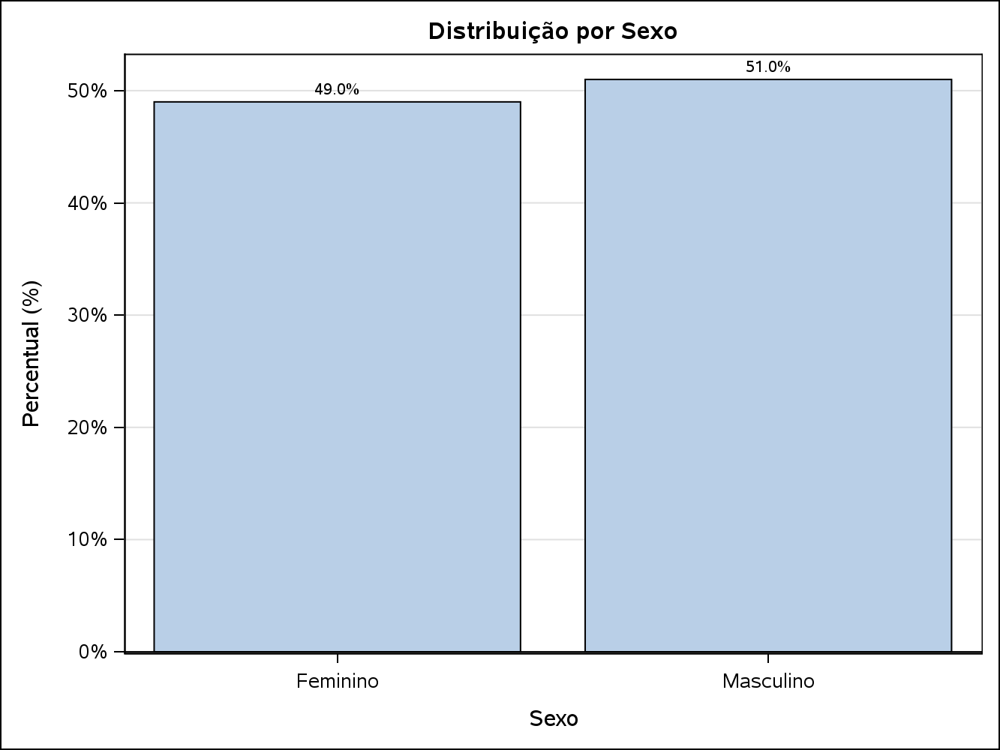{width=70%}

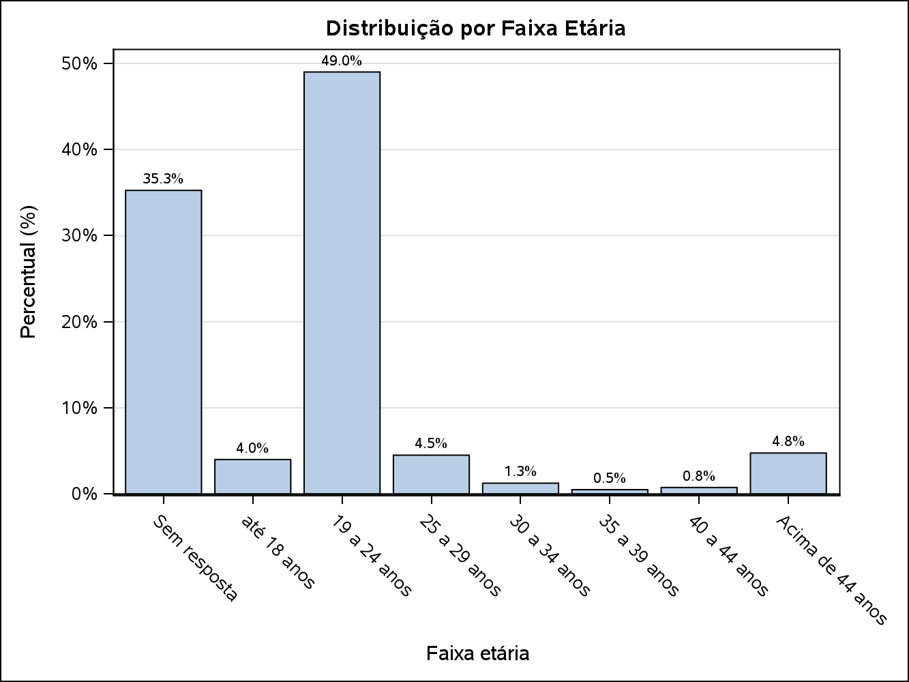{width=80%}

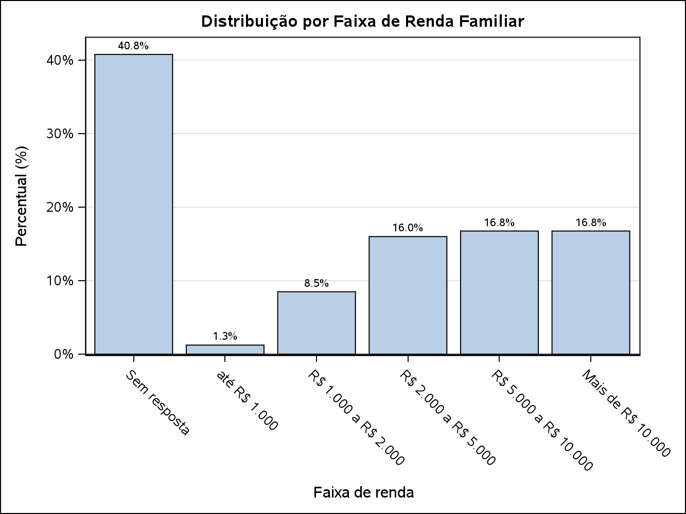{width=80%}

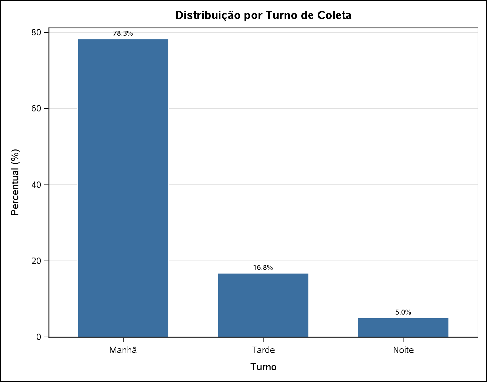{width=70%}

## 4.2 Taxa de resposta

Como detalhado na Seção 3.4, respostas em branco são tratadas como não-resposta (*missing*) nas perguntas de intenção de voto: a taxa de resposta é de **66,00%** (264 de 400) para Presidente e para Governador — os mesmos 136 respondentes (34,00%) deixaram as duas perguntas em branco. Essa é uma taxa de não-resposta expressivamente mais alta que a observada nas demais variáveis de perfil, e deve ser lida como uma limitação relevante do levantamento (Seção 5).

## 4.3 Estimativas pontuais, erro-padrão e IC 95% (PROC SURVEYFREQ, n válido = 264)

**Presidente:**

| Candidato | $\hat{p}$ (%) | Erro-padrão | IC 95% |
|---|---|---|---|
| Luiz Inácio Lula da Silva | 61,36 | 3,00 | [55,45 ; 67,28] |
| Renan Santos | 8,71 | 1,74 | [5,29 ; 12,14] |
| Flavio Bolsonaro | 7,95 | 1,67 | [4,67 ; 11,24] |
| Nulo | 5,30 | 1,38 | [2,58 ; 8,02] |
| Branco | 4,55 | 1,28 | [2,02 ; 7,07] |
| Não sei/não quero responder | 3,41 | 1,12 | [1,21 ; 5,61] |
| Ronaldo Caiado | 2,65 | 0,99 | [0,70 ; 4,60] |
| Augusto Cury | 2,65 | 0,99 | [0,70 ; 4,60] |
| Samara Martins | 1,52 | 0,75 | [0,03 ; 3,00] |
| Edmilson Costa | 0,76 | 0,53 | [0,00 ; 1,81] |
| Rui Costa Pimenta | 0,38 | 0,38 | [0,00 ; 1,12] |
| Hertz Dias | 0,38 | 0,38 | [0,00 ; 1,12] |
| Romeu Zema | 0,38 | 0,38 | [0,00 ; 1,12] |

**Governador:**

| Candidato | $\hat{p}$ (%) | Erro-padrão | IC 95% |
|---|---|---|---|
| Leandro Grass | 56,06 | 3,06 | [50,03 ; 62,09] |
| Não sei/Não quero responder | 12,88 | 2,07 | [8,81 ; 16,95] |
| Celina Leão | 8,71 | 1,74 | [5,29 ; 12,14] |
| Nulo | 6,06 | 1,47 | [3,16 ; 8,96] |
| Branco | 4,55 | 1,28 | [2,02 ; 7,07] |
| Ricardo Cappelli | 3,41 | 1,12 | [1,21 ; 5,61] |
| José Roberto Arruda | 2,65 | 0,99 | [0,70 ; 4,60] |
| Kiko Caputo | 2,65 | 0,99 | [0,70 ; 4,60] |
| Paula Belmonte | 1,52 | 0,75 | [0,03 ; 3,00] |
| Professor Robson | 0,76 | 0,53 | [0,00 ; 1,81] |
| Expedito Mendonça | 0,38 | 0,38 | [0,00 ; 1,12] |
| Professora Samara Mineiro | 0,38 | 0,38 | [0,00 ; 1,12] |

**Margem de erro nominal (n=400, p=0,5, nc = 95%, pior caso):** ±4,91 pontos percentuais\
**Margem de erro efetiva (n válido=264, descontando os 34,00% de não-resposta):** ±6,06 pontos percentuais

> A não-resposta reduziu o n efetivo de 400 para 264, o que **aumentou consideravelmente** a margem de erro, de ±4,91 p.p. para ±6,06 p.p., resultando em um efeito real e substancial (1,15 p.p.), decorrente de uma taxa de não-resposta de 34,00%.

### 4.3.1 Demonstração do cálculo: efeito da não-resposta na margem de erro

A margem de erro acima usa o cenário de pior caso ($p=0,5$) para toda a amostra. Para tornar o efeito da não-resposta mais concreto, demonstra-se abaixo o cálculo completo — variância, erro-padrão e margem de erro, pela fórmula de Cochran (Seção 2.2) — para os dois candidatos mais votados, comparando o $n$ efetivamente observado (264, com a não-resposta de 34,00%) com um cenário hipotético em que a mesma proporção de votos tivesse sido obtida sobre os 400 respondentes nominais, sem nenhuma recusa:

$$\text{var}(\hat p) = \frac{\hat p(1-\hat p)}{n-1} \qquad \text{se}(\hat p) = \sqrt{\text{var}(\hat p)} \qquad \text{margem} = t_{(0{,}975;\,n-1)} \times \text{se}(\hat p)$$

**Luiz Inácio Lula da Silva (Presidente):** $\hat p = 162/264 = 0,6136$ (61,36%)

| Cenário | $n$ | $\hat p(1-\hat p)$ | var($\hat p$) | se($\hat p$) | $t_{(0,975;\,n-1)}$ | Margem | IC 95% |
|---|---|---|---|---|---|---|---|
| Real (com não-resposta) | 264 | 0,6136 × 0,3864 = 0,2371 | 0,2371/263 = 0,000901 | 3,00% | 1,9690 | 5,91 p.p. | [55,45% ; 67,28%] |
| Hipotético (sem não-resposta) | 400 | 0,6136 × 0,3864 = 0,2371 | 0,2371/399 = 0,000594 | 2,44% | 1,9659 | 4,79 p.p. | [56,57% ; 66,16%] |

A margem de erro para Lula passou de ±4,79 p.p. (se não houvesse não-resposta) para ±5,91 p.p. (cenário real) — um aumento de 1,12 p.p., só pela redução do $n$ de 400 para 264 (a proporção $\hat p$ foi mantida fixa nos dois cálculos, isolando o efeito do tamanho da amostra sobre a precisão).

**Leandro Grass (Governador):** $\hat p = 148/264 = 0,5606$ (56,06%)

| Cenário | $n$ | $\hat p(1-\hat p)$ | var($\hat p$) | se($\hat p$) | $t_{(0,975;\,n-1)}$ | Margem | IC 95% |
|---|---|---|---|---|---|---|---|
| Real (com não-resposta) | 264 | 0,5606 × 0,4394 = 0,2463 | 0,2463/263 = 0,000937 | 3,06% | 1,9690 | 6,03 p.p. | [50,03% ; 62,09%] |
| Hipotético (sem não-resposta) | 400 | 0,5606 × 0,4394 = 0,2463 | 0,2463/399 = 0,000617 | 2,48% | 1,9659 | 4,88 p.p. | [51,18% ; 60,95%] |

Para Leandro Grass, a margem de erro passou de ±4,88 p.p. para ±6,03 p.p. — aumento de 1,15 p.p., na mesma linha do observado para Lula e do efeito genérico (p=0,5) já reportado acima. Em ambos os casos, a redução de $n$ causada pela não-resposta de 34,00% é responsável por todo o aumento, já que a proporção $\hat p$ foi mantida idêntica entre os dois cenários.

{width=85%}

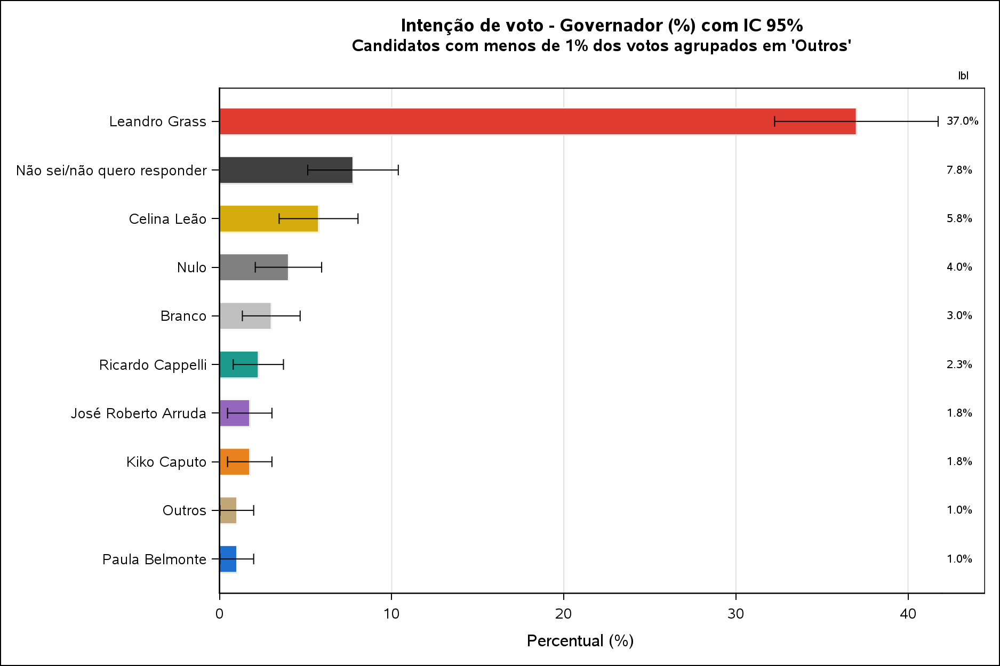{width=85%}

## 4.4 Análise por subgrupos (Sexo, Turno, Faixa Etária, Faixa de Renda)

Os testes qui-quadrado de associação entre o candidato escolhido e cada variável de perfil indicaram:

| Cruzamento | Qui-quadrado (GL) | p-valor | Observação |
|---|---|---|---|
| Presidente x Sexo | 28,50 (12) | **0,0047** | 62% das células com contagem esperada <5 — teste pode não ser válido |
| Governador x Sexo | 10,37 (11) | 0,4971 | 58% das células com contagem esperada <5 — não significativo |
| Presidente x Faixa de Renda | 61,60 (60) | 0,4185 | 86% das células com contagem esperada <5 — não significativo |
| Presidente x Faixa Etária | 199,50 (84) | <0,0001 | 89% das células com contagem esperada <5 — teste pode não ser válido |
| Presidente x Turno | 33,99 (24) | 0,0849 | 74% das células com contagem esperada <5 — não significativo |
| Governador x Faixa de Renda | 60,93 (55) | 0,2712 | 85% das células com contagem esperada <5 — não significativo |
| Governador x Faixa Etária | 143,66 (77) | <0,0001 | 89% das células com contagem esperada <5 — teste pode não ser válido |
| Governador x Turno | 43,02 (22) | **0,0047** | 69% das células com contagem esperada <5 — teste pode não ser válido |

- **Sexo:** resultado também diferente entre os dois cargos. Para **Presidente**, o teste qui-quadrado indicou associação estatisticamente significativa entre sexo e candidato escolhido (p=0,0047). Para **Governador**, não houve evidência de associação (p=0,4971). Como em 62% das células a contagem esperada é menor que 5 (reflexo dos candidatos minoritários terem poucos votos), o resultado de Presidente deve ser lido como indício, não como conclusão definitiva.
- **Faixa de renda:** diferente do que se observava antes do tratamento da não-resposta desta versão da base, o cruzamento **deixou de ser estatisticamente significativo** para os dois cargos (Presidente p=0,4185; Governador p=0,2712). Ou seja, não há evidência, nesta amostra, de que a faixa de renda esteja associada ao candidato escolhido.
- **Faixa etária:** continua fortemente significativa para os dois cargos (p<0,0001), mas sofre de forte esparsidade (89% das células com contagem esperada <5 em ambos), dado o grande número de categorias de candidatos combinado com faixas pouco povoadas (ex.: 35 a 39 anos tem apenas 2 respondentes no total). A leitura qualitativa dos gráficos é mais confiável que o p-valor nesse caso.
- **Turno:** o resultado foi diferente entre os dois cargos. Para **Governador**, o teste qui-quadrado indicou diferença estatisticamente significativa na intenção de voto entre os turnos (p=0,0047). Para **Presidente**, não houve evidência de associação (p=0,0849), embora mais próxima do limiar de 5% do que antes do tratamento da não-resposta. **Importante:** em ambos os cruzamentos, o próprio SAS alerta que mais de 2/3 das células têm contagem esperada menor que 5 (reflexo do turno Noite ter apenas 20 respondentes e dos candidatos minoritários terem poucas respostas) — isso torna o teste qui-quadrado estatisticamente pouco confiável nesses cruzamentos, e deve ser mencionado como limitação ao relatar esses resultados, inclusive o único que deu significativo (Governador x Turno), não como conclusão definitiva.

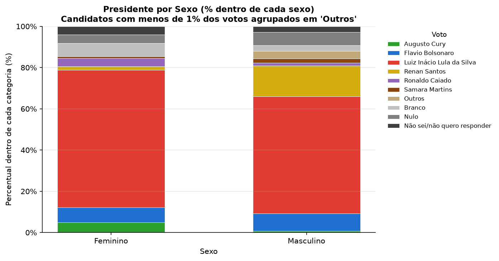{width=80%}

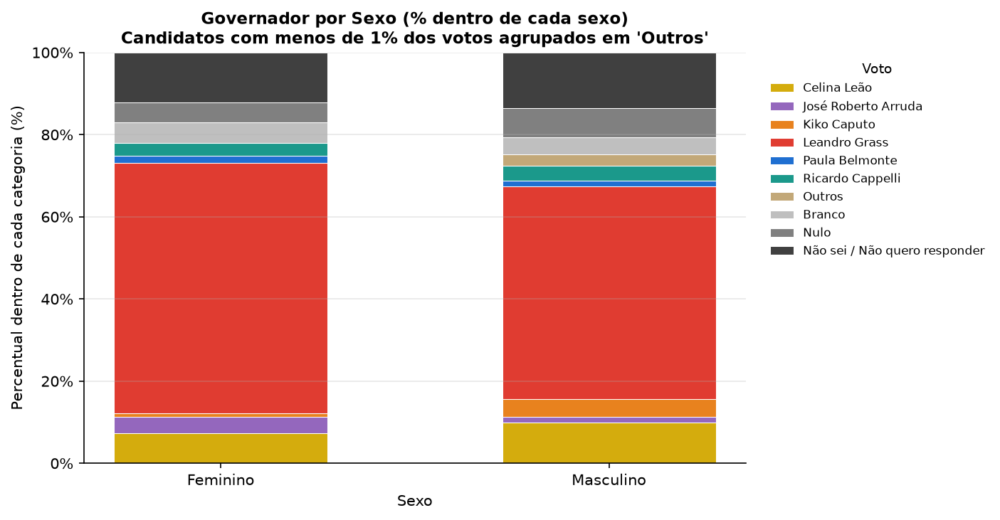{width=80%}

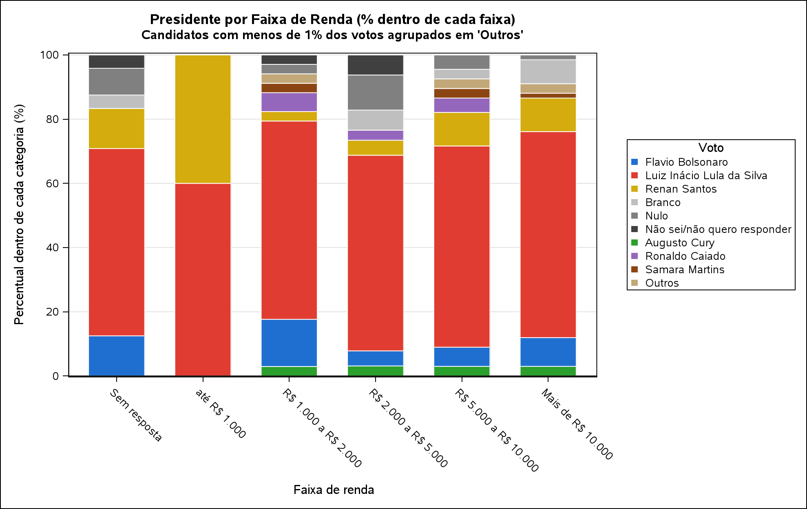{width=85%}

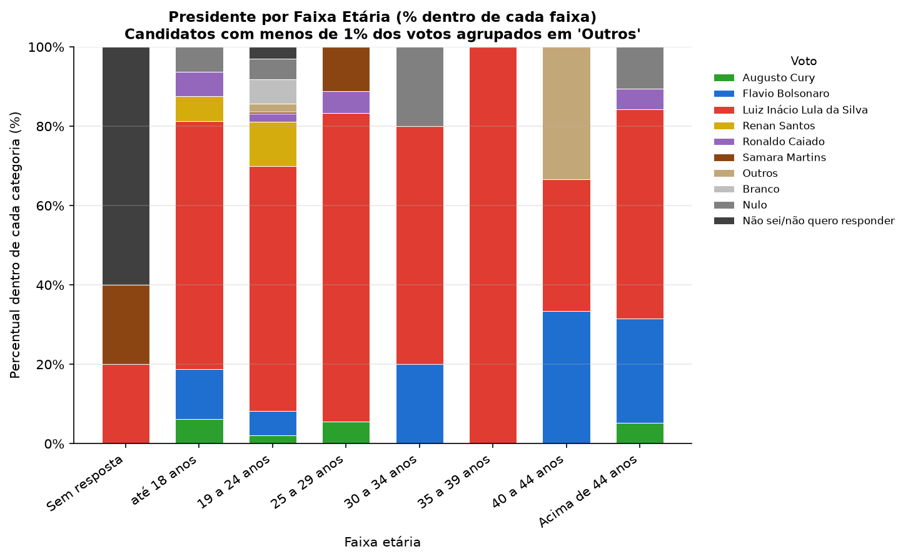{width=85%}

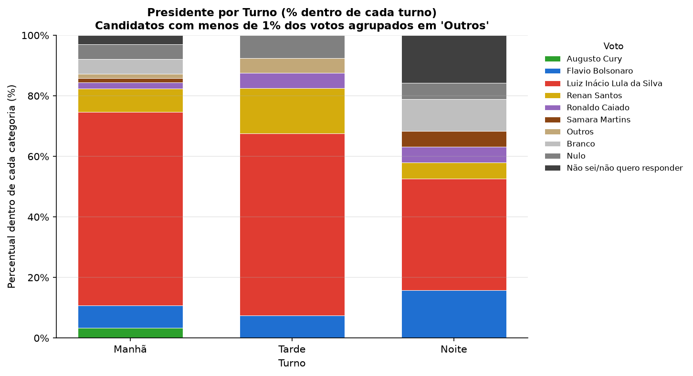{width=80%}

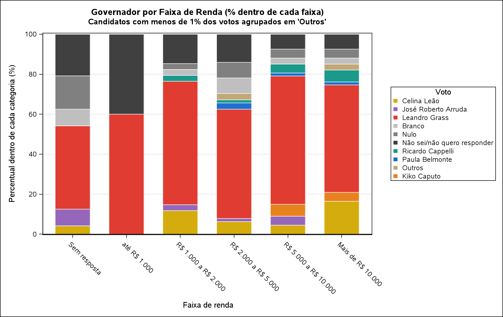{width=85%}

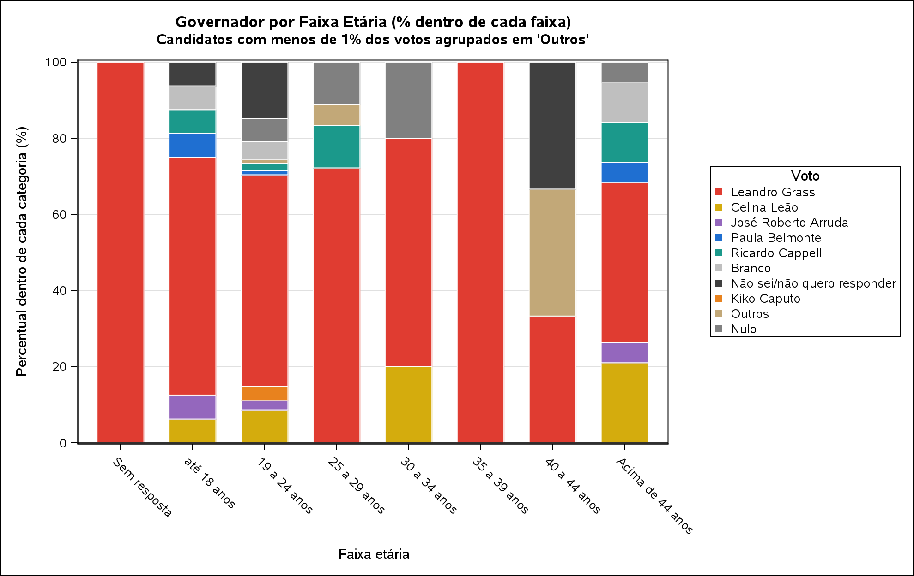{width=85%}

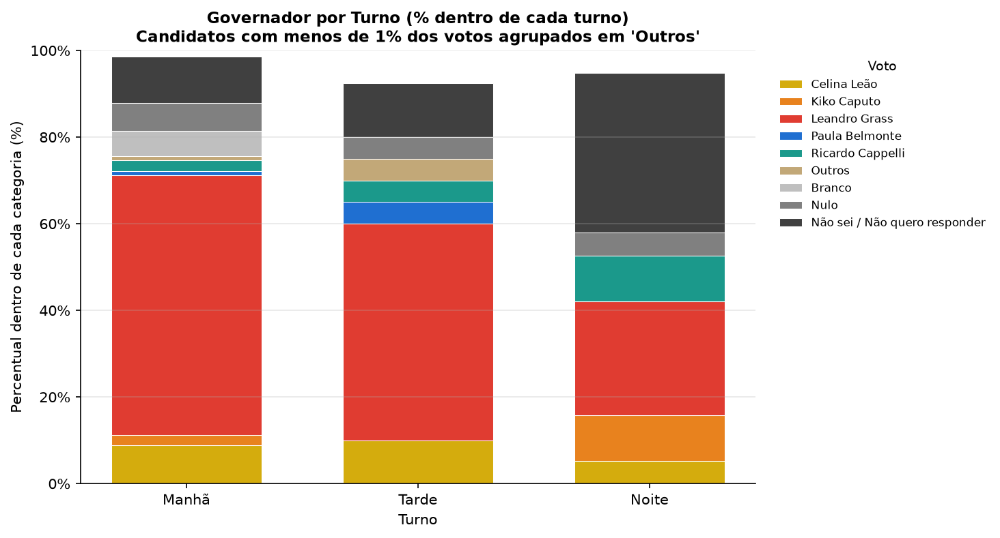{width=80%}

# 5. Conclusões

A pesquisa eleitoral conduzida nos pavilhoes João Calmon e Anisio Teixeira em Brasília, com uma amostra de 400 eleitores coletados por amostragem sistemática (com intervalo $K$ próprio de cada entrevistador, conforme sorteio inicial — Seção 2), permitiu estimar a intenção de voto para Presidente e Governador com margem de erro de aproximadamente ±4,91 pontos percentuais (nominal) e ±6,06 pontos percentuais (efetiva, considerando a não-resposta de 34,00%).

O candidato à Presidência com maior intenção de voto foi **Luiz Inácio Lula da Silva** (61,36%, IC 95%: [55,45%; 67,28%]). Para Governador, o líder foi **Leandro Grass** (56,06%, IC 95%: [50,03%; 62,09%]), com uma parcela expressiva de indecisos ("Não sei/Não quero responder", 12,88%) — diferente de Presidente, em que essa categoria ficou bem menor (3,41%).

A análise por subgrupos indicou que a **faixa etária** é a variável mais associada à intenção de voto para os dois cargos (p<0,0001), enquanto **faixa de renda não mostrou associação significativa** para nenhum dos dois (Presidente p=0,4185; Governador p=0,2712). Para **turno** e para **sexo**, o resultado divergiu entre os cargos em direções opostas: turno foi significativo para Governador (p=0,0047) mas não para Presidente (p=0,0849); sexo foi significativo para Presidente (p=0,0047) mas não para Governador (p=0,4971). Mesmo os resultados significativos devem ser interpretados com cautela, já que a validade do teste é limitada pela baixa contagem esperada em boa parte das células (69% no cruzamento Governador x Turno, 62% em Presidente x Sexo), decorrente do pequeno número de entrevistas no turno da Noite (n=20) e de candidatos minoritários com poucos votos. Recomenda-se tratar esses achados como indícios a serem investigados, não como conclusões definitivas.

Como limitações do estudo, destacam-se: (i) a **não-resposta de 34,00% nas perguntas de voto** — bem mais alta que em qualquer outra variável do estudo —, que reduz consideravelmente o n efetivo e aumenta a margem de erro, com indício de não-resposta diferencial por sexo (mulheres 37,24% vs. homens 30,88% — Seção 3.4), o que é um ponto de atenção relevante para a validade externa das estimativas.

# Referências {.unnumbered}

BOLFARINE, H.; BUSSAB, W. O. *Elementos de Amostragem*. São Paulo: Instituto de Matemática e Estatística, USP, 2004.

COCHRAN, W. G. *Sampling Techniques*. 3. ed. New York: John Wiley & Sons, 1977.

ECHEGARAY, F. O papel das pesquisas de opinião pública na consolidação da democracia: a experiência latino-americana. *Opinião Pública*, Campinas, v. 7, n. 1, 2001.
