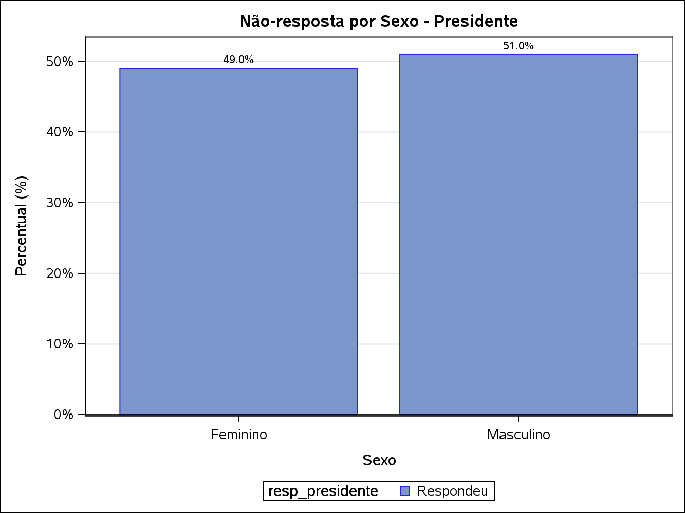
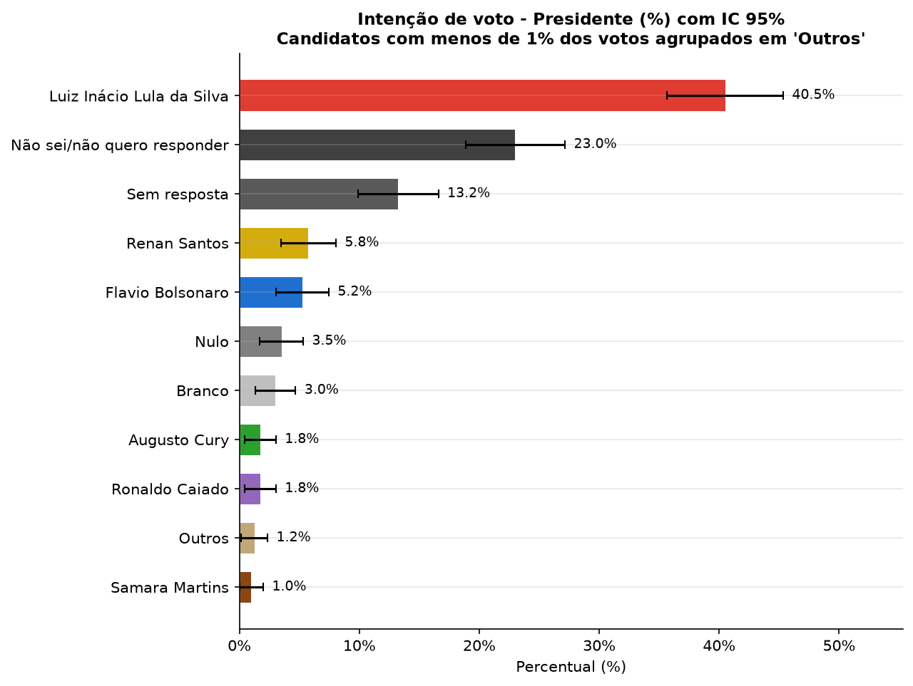
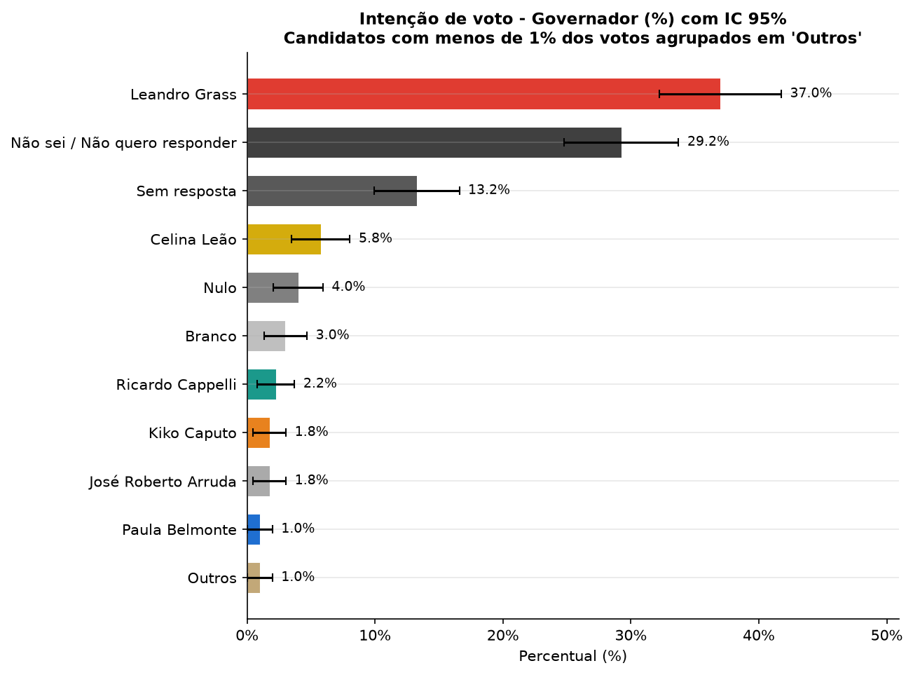
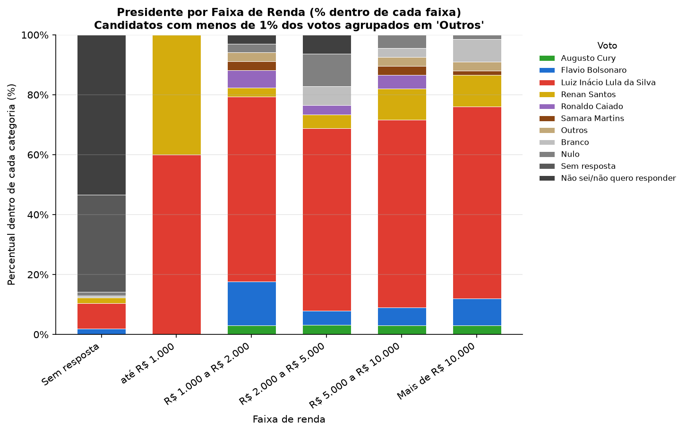
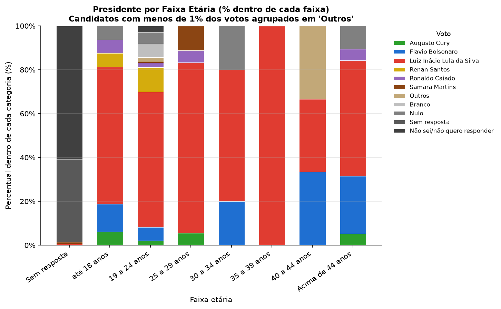
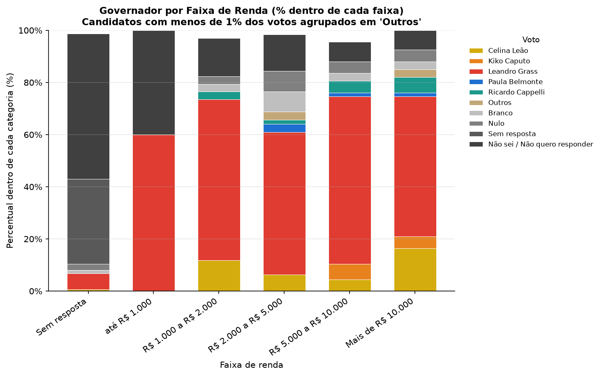
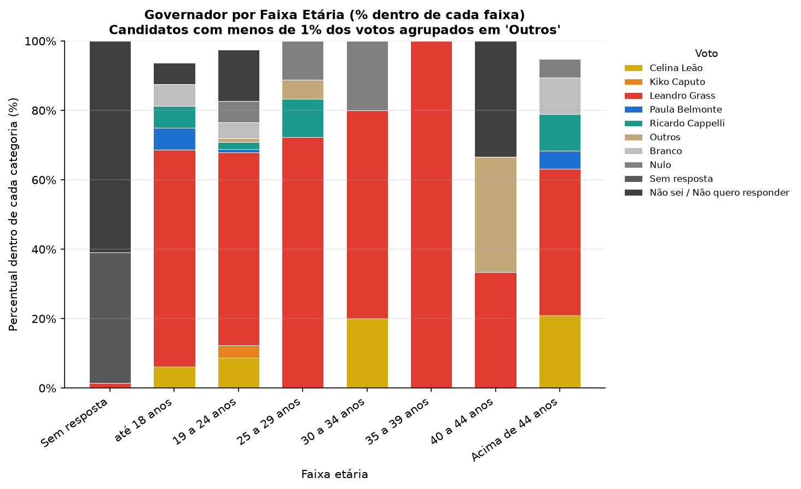
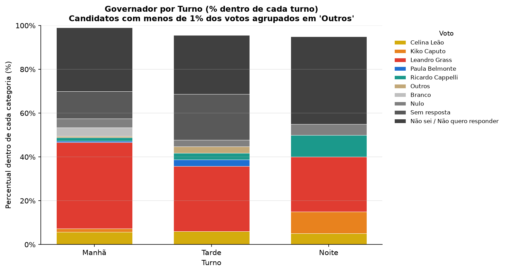

# Resumo

As pesquisas de opinião pública ocupam papel central nos processos democráticos, funcionando como mediadoras entre a vontade dos cidadãos e as elites políticas. Este trabalho tem como objetivo estimar a proporção de intenção de voto para os cargos de Presidente e Governador do Distrito Federal, a partir de uma amostra de 400 eleitores abordados presencialmente nos pavilhoes Anísio Teixeira e João Calmon, por meio de amostragem sistemática (K=2) tratada como equivalente à Amostragem Aleatória Simples sem reposição. O tamanho de amostra (n=400) é justificado a partir da fórmula de dimensionamento amostral para uma margem de erro de 5 pontos percentuais. As estimativas pontuais, variâncias e intervalos de confiança foram obtidos via `PROC SURVEYFREQ` no software SAS, com taxa de resposta de 100% nas perguntas de intenção de voto (toda recusa foi registrada explicitamente como "Sem resposta", distinta de "Não sei/não quero responder"). O candidato Luiz Inácio Lula da Silva lidera a intenção de voto para Presidente (40,50%, IC 95%: [35,67%; 45,33%]) e Leandro Grass para Governador (37,00%, IC 95%: [32,25%; 41,75%]). A análise por subgrupos (turno, faixa etária e faixa de renda) indicou diferença estatisticamente significativa na intenção de voto entre turnos de coleta apenas para o cargo de Governador, não para Presidente, com ressalvas quanto à validade do teste qui-quadrado em todos os cruzamentos dado o pequeno número de observações esperadas em boa parte das células.

**Palavras-chave:** amostragem, amostragem sistemática, pesquisa eleitoral, intervalo de confiança, margem de erro, não-resposta.

# 1. Introdução

As pesquisas de opinião pública ocupam um papel central nos processos democráticos contemporâneos, funcionando como um dos principais mecanismos de mediação entre a vontade dos cidadãos e as elites políticas. Echegaray (2001) destaca que, desde os anos 1980, os levantamentos de opinião se tornaram centrais nos processos de consolidação democrática na América Latina, contribuindo para o aprimoramento da representação política e para a legitimidade dos resultados eleitorais. No entanto, o autor alerta para o risco de que esses instrumentos sejam manipulados por atores interessados em deslegitimar o próprio processo democrático. Desta forma, a condução tecnicamente rigorosa de uma pesquisa eleitoral, com um técnicas sólidas e a quantificação explícita de sua margem de erro, é condição necessária para que ela efetivamente cumpra essa função de informar o debate público.

No Brasil, esse papel das pesquisas eleitorais ganha relevância em períodos de eleição, quando a intenção de voto da população se torna uma informação disputada tanto por campanhas políticas quanto pelo eleitorado, que a utiliza para acompanhar a corrida eleitoral e formar sua própria decisão de voto. Conhecer, com um nível de confiança estatístico adequado, a proporção de apoio a cada candidato antes do pleito permite não apenas orientar estratégias de campanha, mas também fornecer à sociedade um retrato mais fidedigno do cenário eleitoral do que impressões assistemáticas ou amostras de conveniência.

Em Brasília, esse cenário se expressa na disputa pelos cargos de Presidente da República e Governador do Distrito Federal, ambos decididos no mesmo pleito. Nesse contexto, conduziu-se uma pesquisa eleitoral presencial na cidade, com coleta de dados realizada junto a visitantes de pavilhões João Calmon e Anísio Teixeira, por meio de um plano amostral sistemático que buscou garantir representatividade ao longo de diferentes turnos do dia (manhã, tarde e noite).

Para tanto, foram abordadas 400 pessoas nos pavilhões Anísio Teixeira e João Calmon por meio de amostragem sistemática (K=2), com início aleatório sorteado entre a 1ª e a 2ª pessoa da sequência de chegada ao pavilhão. Em cada abordagem, registrou-se o sexo, a faixa etária, a faixa de renda familiar, o turno da coleta e a intenção de voto para Presidente e Governador, sendo os casos de recusa tratados como não-resposta.

## 1.1 Objetivos

O objetivo geral deste trabalho é estimar a proporção de intenção de voto para os cargos de Presidente e Governador do Distrito Federal, a partir de uma amostra probabilística de eleitores coletada em pavilhões de Brasília.

Os objetivos específicos são:

- calcular a margem de erro e o intervalo de confiança associados às estimativas de intenção de voto, com base no plano amostral adotado;
- justificar, por meio da fórmula de dimensionamento amostral, o tamanho de amostra (n=400) efetivamente utilizado na coleta;
- avaliar o efeito da não-resposta sobre a precisão das estimativas, incluindo a verificação de não-resposta diferencial entre grupos;
- verificar se há diferenças na intenção de voto entre subgrupos da amostra (turno de coleta, faixa etária e faixa de renda).

# 2. Referencial Teórico

A coleta foi conduzida por **amostragem sistemática**, com intervalo $K=2$: a cada 2 pessoas que passavam pelos pavilhões, 1 era abordada, com início aleatório sorteado entre a 1ª e a 2ª pessoa da sequência. Para fins de estimação de variância e erro-padrão, a amostragem sistemática foi tratada de forma equivalente à Amostragem Aleatória Simples sem reposição (AASs) — prática padrão quando a população está em "ordem aleatória" (ausência de periodicidade ou tendência), como justificado por Cochran (1977) e Bolfarine & Bussab (2004).

## 2.1 Notação e parâmetros populacionais

Para uma população de tamanho $N$, com valores $Y_1,\dots,Y_N$, definem-se a média, o total e a variância populacionais (Cochran, 1977, Eq. 2.6–2.7; Bolfarine & Bussab, 2004, Cap. 2):

$$\bar{Y} = \frac{1}{N}\sum_{i=1}^{N} Y_i, \qquad \tau = \sum_{i=1}^{N} Y_i, \qquad S^2 = \frac{1}{N-1}\sum_{i=1}^{N}(Y_i-\bar{Y})^2$$

Para variáveis categóricas (como o candidato escolhido), define-se $Y_i=1$ se a unidade $i$ pertence à classe de interesse $C$ e $Y_i=0$ caso contrário, de modo que $\bar{Y}=P=A/N$ é a proporção populacional na classe $C$ (Cochran, 1977, Cap. 3, Eq. 3.1–3.2).

## 2.2 Estimador pontual e variância (AAS sem reposição)

Dentro do plano AASs, a proporção amostral $p=a/n$ (onde $a$ é o número de respondentes na classe $C$, dentre os $n$ válidos) é um estimador não viesado de $P$ (Cochran, 1977, Teorema 3.1; Bolfarine & Bussab, 2004, Corolário 3.4). Sua variância é:

$$Var(p) = \frac{S^2}{n}\left(\frac{N-n}{N}\right) = \frac{PQ}{n}\left(\frac{N-n}{N-1}\right), \qquad Q = 1-P$$

(Cochran, 1977, Teorema 2.2 e Eq. 3.6; Bolfarine & Bussab, 2004, Eq. 3.30). O fator $(N-n)/N = 1-f$, onde $f=n/N$ é a fração amostral, é chamado **correção de população finita** (*fpc*) — ele só é aplicável quando $N$ é conhecido e finito. Quando a população é desconhecida ou muito grande em relação à amostra (caso deste trabalho, em que a população de eleitores é muito maior que $n=400$), o fpc tende a 1 e a variância se reduz à forma usual:

$$Var(p) \approx \frac{p(1-p)}{n}$$

O estimador amostral não viesado dessa variância, substituindo $P,Q$ pelos valores amostrais $p,q=1-p$, é (Cochran, 1977, Eq. 3.8; Bolfarine & Bussab, 2004, Eq. 3.31–3.32 com divisor $n-1$):

$$var(p) = (1-f)\,\frac{p\,q}{n-1}$$

## 2.3 Erro-padrão e intervalo de confiança

O erro-padrão é $EP(p)=\sqrt{Var(p)}$. Assumindo normalidade assintótica de $p$ (válida para $n$ suficientemente grande, Bolfarine & Bussab, 2004, Seção 3.3.4), o intervalo de confiança aproximado de coeficiente $1-\alpha$ para $P$ é (Cochran, 1977, Eq. 2.23; Bolfarine & Bussab, 2004, Eq. 3.32):

$$IC(P;\,1-\alpha) = p \pm Z_{\alpha/2}\sqrt{(1-f)\,\frac{p\,q}{n-1}}$$

onde $Z_{\alpha/2}$ é o percentil da Normal padrão para a confiança desejada (ex.: $Z=1{,}96$ para 95%). Para $N$ desconhecido/grande, $f\to 0$ e o intervalo se reduz a $p \pm Z_{\alpha/2}\sqrt{p(1-p)/n}$, forma empregada pelo `PROC SURVEYFREQ` do SAS neste trabalho.

## 2.4 Determinação do tamanho da amostra

Fixada uma margem de erro tolerável $d$ e um risco $\alpha$ de que o erro real exceda $d$, isto é, $\Pr(|p-P|\geq d)=\alpha$, resolve-se para $n$ a partir da variância de $p$ (Cochran, 1977, Seção 4.4, Eq. 4.1):

$$n = \dfrac{\dfrac{Z_{\alpha/2}^2\,PQ}{d^2}}{1+\dfrac{1}{N}\left(\dfrac{Z_{\alpha/2}^2\,PQ}{d^2}-1\right)}$$

Como $P$ raramente é conhecido a priori, usa-se uma estimativa prévia $p$ (ou o cenário de pior caso $p=0{,}5$, que maximiza $PQ$). Para $N$ grande/desconhecido, a expressão se reduz à primeira aproximação (Cochran, 1977, Eq. 4.2; Bolfarine & Bussab, 2004, Eq. 3.29 com $D=B^2/z_\alpha^2$):

$$n_0 = \frac{Z_{\alpha/2}^2\,p(1-p)}{d^2}$$

Na prática, é comum arredondar $Z_{\alpha/2}\approx 2$ para o nível de confiança de 95% (em vez do valor exato $1{,}96$), o que simplifica a fórmula no cenário de pior caso ($p=0{,}5$, logo $p(1-p)=0{,}25$):

$$n_0 = \frac{2^2 \times 0{,}25}{d^2} = \frac{1}{d^2}$$

Essa é a fórmula usada na Seção 3.3 deste relatório para justificar o $n=400$ efetivamente coletado.

## 2.5 Amostragem sistemática

Considerando uma população com $N$ elementos ordenados de 1 a $N$, com $N=kn$ ($k$ inteiro). Uma unidade é sorteada aleatoriamente entre as $k$ primeiras unidades (número aleatório inicial $r\in\{1,\dots,k\}$), e as demais unidades da amostra são obtidas a intervalos regulares de comprimento $k$ (Cochran, 1977, Cap. 8, Seção 8.1; Bolfarine & Bussab, 2004, Seção 7.8):

$$\text{elementos selecionados} = r,\ r+k,\ r+2k,\ \dots,\ r+(n-1)k$$

Neste trabalho, $k=K=2$. Cochran (1977, Seção 8.2) mostra que a amostragem sistemática equivale à seleção aleatória de **um único conglomerado** dentre $k$ conglomerados possíveis (cada um com $n$ unidades), de modo que sua variância verdadeira é:

$$V(\bar{y}_{sis}) = \frac{N-1}{N}S^2 - \frac{k(n-1)}{N}S^2_{wsy}$$

(Cochran, 1977, Teorema 8.1; equivalentemente, Bolfarine & Bussab, 2004, Eq. 7.6–7.8, em termos do coeficiente de correlação intraclasse $\rho_{int}$: $V_k=\{1+\rho_{int}(n-1)\}\,\sigma^2/n$). Quando a população está em ordem aleatória (sem tendência ou periodicidade), a amostragem sistemática tem precisão próxima à da AAS, e sua variância pode ser estimada pelo mesmo estimador usado na AAS (Bolfarine & Bussab, 2004, Eq. 7.7; Corolário 3.5). É essa a aproximação adotada neste trabalho: não há motivo para supor que a ordem de chegada das pessoas ao pavilhão seja cíclica ou correlacionada com a intenção de voto, de modo que se trata a variância da amostra sistemática ($K=2$) como equivalente à da AASs.

# 3. Materiais e Métodos

Toda a análise estatística deste trabalho foi conduzida no **software SAS**, utilizando os procedimentos `PROC IMPORT` (leitura da base), `PROC FREQ` e `PROC SURVEYFREQ` (estimativas de proporção, variância e intervalo de confiança), `PROC SGPLOT` (gráficos) e `DATA` steps para tratamento da base e cálculos auxiliares. O script completo está disponível no arquivo `trabalho_amostragem.sas`.

## 3.1 Local e procedimento de coleta

A coleta foi realizada presencialmente em pavilhões na cidade de Brasília, por meio de abordagem direta aos visitantes. O plano amostral de campo foi a **amostragem sistemática com $K=2$**: a cada 2 pessoas que passavam pelo local, 1 era selecionada para ser entrevistada, com início aleatório sorteado entre a 1ª e a 2ª pessoa da sequência de chegada.

{width=70%}

A coleta foi dividida em três turnos (Manhã, Tarde e Noite), cada um conduzido por um membro/subgrupo da equipe. Antes da análise, foram descartadas 18 linhas totalmente vazias ao final da planilha (artefato da ferramenta de coleta), restando 400 registros válidos. Também foi identificada uma inconsistência de digitação na base: a resposta "Samara Martins (11)" aparecia sob duas grafias (uma com espaço em branco inicial), o que a fazia contar como duas categorias distintas nas tabelas de frequência. Essa inconsistência foi corrigida com `strip()` nas colunas de candidato:

```sas
data amostra;
    set amostra;
    if missing(Timestamp) then delete;   /* descarta linhas vazias (artefato) */
    id = _n_;
    presidente = strip(presidente);
    governador = strip(governador);
run;
```

## 3.2 População de referência e correção de população finita (fpc)

Embora os respondentes abordados nos pavilhões não constituam uma amostra probabilística de todo o eleitorado do Distrito Federal (ver limitações, Seção 5), o tamanho desse eleitorado foi usado para **formalizar, em vez de apenas presumir**, a decisão de omitir a correção de população finita (fpc) nas estimativas de intenção de voto. Segundo o TRE-DF (julho/2026), o Distrito Federal possui $N=2.562.037$ eleitores. Com $n=400$ (Seção 4.3 — a base final não tem nenhum valor ausente nas perguntas de voto, ver Seção 3.4), a fração amostral é:

$$f = \frac{n}{N} \approx \frac{400}{2.562.037} \approx 0{,}0000156 \;(0{,}0016\%)$$

de modo que o fator de correção $fpc=\sqrt{1-f}\approx 0{,}9999$ — um efeito numérico desprezível sobre o erro-padrão das estimativas (não altera nenhum resultado reportado em casas decimais relevantes). Esse valor de $N$ foi informado ao `PROC SURVEYFREQ` por meio da opção `TOTAL=`, confirmando explicitamente — com fonte oficial — que a população pode ser tratada como efetivamente infinita para fins de variância, em vez de simplesmente assumir isso sem verificação:

```sas
%let N_DF = 2562037;  /* TRE-DF, julho/2026 */

proc surveyfreq data=amostra order=freq total=&N_DF.;
    tables presidente / cl;
run;
```

Fonte: TRE-DF (2026). *Distrito Federal ultrapassa 2,56 milhões de eleitores e registra 94,4% do eleitorado apto com biometria*. Disponível em: <https://www.tre-df.jus.br/comunicacao/noticias/2026/Julho/distrito-federal-ultrapassa-2-56-milhoes-de-eleitores-e-registra-94-4-do-eleitorado-apto-com-biometria-1>.

## 3.3 Justificativa do tamanho da amostra (n = 400)

Embora os dados já estivessem integralmente coletados, o tamanho de amostra de **n = 400** pessoas pode ser justificado "por engenharia reversa", a partir da margem de erro $e=5\%$ admitida, com confiança de aproximadamente 95% ($Z\approx2$) e cenário de pior caso ($p=0{,}5$, que maximiza a variância):

$$n_0 = \frac{Z^2\,p(1-p)}{e^2} = \frac{2^2 \times 0{,}5 \times 0{,}5}{0{,}05^2} = \frac{1}{0{,}05^2} = \frac{1}{e^2} = 400$$

O resultado bate **exatamente** com o $n=400$ efetivamente coletado — confirmando que o plano amostral foi dimensionado para uma margem de erro de 5 pontos percentuais, com 95% de confiança, seguindo a regra prática $n_0=1/e^2$ usual em pesquisas eleitorais no Brasil. Esse cálculo foi implementado no SAS como:

```sas
data _null_;
    Z = 2;         /* aproximação usual para 95% de confiança */
    p = 0.5;       /* cenário de pior caso (variância máxima) */
    e = 0.05;      /* margem de erro admitida: 5 pontos percentuais */

    n0 = (Z**2 * p*(1-p)) / (e**2);   /* = 1/e² */

    put "n necessário (n0 = 1/e²): " n0 best6.;
run;
```

## 3.4 Tratamento da não-resposta

Quando um visitante era abordado e recusava participar da pesquisa ("Você quer fazer a pesquisa?" / "Não"), a recusa era documentada fotograficamente em campo e registrada no instrumento de coleta. Na base final utilizada nesta análise, todas essas recusas foram codificadas explicitamente como **"Sem resposta"** — uma categoria de resposta válida, diferente de **"Não sei/não quero responder"** (que indica um respondente que engajou com a pergunta, mas declarou indecisão ou preferiu não revelar o voto). Por isso, não há nenhum valor ausente (*missing*) nas variáveis de intenção de voto: a taxa de resposta é de **100%** para Presidente e Governador, inclusive sem diferença entre sexos (ver Figura abaixo). Essa distinção é importante — agrupar "Sem resposta" com "Não sei/não quero responder" misturaria um problema de qualidade/cobertura da coleta com um achado substantivo sobre indecisão do eleitorado, por isso as duas categorias são mantidas separadas em todas as tabelas e gráficos deste relatório:

```sas
data amostra;
    set amostra;
    resp_presidente = ifc(missing(presidente), 'Nao respondeu', 'Respondeu');
    resp_governador = ifc(missing(governador), 'Nao respondeu', 'Respondeu');
run;

proc surveyfreq data=amostra order=freq total=&N_DF.;
    tables presidente / cl;
run;
```

{width=60%}

```sas
data amostra;
    set amostra;
    resp_presidente = ifc(missing(presidente), 'Nao respondeu', 'Respondeu');
    resp_governador = ifc(missing(governador), 'Nao respondeu', 'Respondeu');
run;

proc surveyfreq data=amostra order=freq total=&N_DF.;
    tables presidente / cl;
run;
```

## 3.5 Agrupamento de candidatos minoritários nos gráficos ("Outros")

Com 13 a 14 categorias de resposta por cargo (candidatos mais Branco, Nulo, "Sem resposta" e "Não sei/não quero responder"), os gráficos de barra — sobretudo as legendas dos gráficos empilhados da Seção 4.4 — ficavam poluídos e com segmentos minúsculos de difícil leitura. Para simplificar **apenas a visualização**, criou-se a categoria **"Outros"**, que consolida todo candidato cuja votação represente **menos de 1% dos votos válidos** ($n=400$):

- **Presidente:** Edmilson Costa (0,50%), Rui Costa Pimenta (0,25%), Hertz Dias (0,25%) e **Romeu Zema (0,25%)**.
- **Governador:** Professor Robson (0,50%), Expedito Mendonça (0,25%) e Professora Samara Mineiro (0,25%).

Vale registrar que Romeu Zema recebeu cor própria na paleta de candidatos, mas teve apenas 1 voto na amostra (0,25%) — abaixo do corte de 1%. Por decisão do grupo, o critério foi aplicado **sem exceção**, e Romeu Zema foi incluído em "Outros" junto aos demais candidatos minoritários. Branco, Nulo, "Sem resposta" e "Não sei/não quero responder" **não** entram nesse agrupamento, pois não são candidatos — e, na prática, todos ficam folgadamente acima de 1% nos dois cargos, então o critério não os afeta.

Esse agrupamento é usado **somente nos gráficos**; as tabelas de estimativas (Seção 4.3) e os testes qui-quadrado por subgrupo (Seção 4.4) mantêm o detalhamento candidato a candidato, sem nenhuma perda de informação nos resultados numéricos reportados. Nos gráficos (gerados em Python — ver Seção 3.6), o sufixo numérico entre parênteses que identificava o candidato no instrumento de coleta (ex.: "Luiz Inácio Lula da Silva (5)") foi removido dos rótulos, para não ser confundido com um valor de votação; o mesmo nome simplificado é usado nas tabelas deste relatório a partir daqui.

Nos gráficos empilhados (Seção 4.4), a ordem da legenda foi fixada assim: primeiro os candidatos nomeados, em **ordem alfabética**; em seguida "Outros"; e por último, em tons de cinza, o bloco de situações de não-voto (Branco, Nulo, Sem resposta e Não sei/não quero responder) — separando visualmente quem recebeu um voto de quem não indicou um candidato.

## 3.6 Geração dos gráficos em Python

Os gráficos de perfil da amostra (Sexo, Faixa Etária, Faixa de Renda, Turno) e de não-resposta foram gerados diretamente no SAS (`PROC SGPLOT`). Já os gráficos de intenção de voto com IC 95% e os cruzamentos por subgrupo (Seção 4.4) — que exigem o agrupamento "Outros", uma paleta de cores fixa por candidato e uma ordem de legenda específica (Seção 3.5) — foram gerados em **Python** (`pandas`, `matplotlib`, `scipy.stats`), no script `script_python/gerar_graficos.py`. O script lê a mesma planilha (`intenções_de_voto_pavilhões.xlsx`), replica a limpeza e as regras de negócio do `trabalho_amostragem.sas` (remoção de linhas vazias, correção de grafia de candidatos, agrupamento "Outros", fórmula de Cochran com divisor $n-1$ e IC via distribuição t de Student) e salva os PNGs usados neste relatório. Essa divisão de responsabilidades foi adotada porque o controle fino de cor, ordenação de legenda e agrupamento de categorias — recursos centrais para a legibilidade dos gráficos mais densos — é bem mais direto de implementar e depurar em Python do que via `PROC FORMAT`/`ATTRMAP` do SAS.

# 4. Análise dos Resultados

## 4.1 Perfil da amostra

Dos 400 respondentes, o perfil demográfico foi (nenhuma variável de perfil tem valores ausentes nesta base — "Sem resposta" é sempre uma opção explícita do instrumento, nunca uma célula em branco):

| Variável | Categoria | % |
|---|---|---|
| Sexo | Masculino | 51,00% |
| Sexo | Feminino | 49,00% |
| Faixa etária | 19 a 24 anos | 49,00% |
| Faixa etária | Sem resposta (opção explícita) | 35,25% |
| Faixa etária | Acima de 44 anos | 4,75% |
| Faixa etária | 25 a 29 anos | 4,50% |
| Faixa etária | até 18 anos | 4,00% |
| Faixa etária | 30 a 34 anos | 1,25% |
| Faixa etária | 40 a 44 anos | 0,75% |
| Faixa etária | 35 a 39 anos | 0,50% |
| Faixa de renda | Sem resposta (opção explícita) | 40,75% |
| Faixa de renda | Mais de R\$ 10.000 | 16,75% |
| Faixa de renda | R\$ 5.000 a R\$ 10.000 | 16,75% |
| Faixa de renda | R\$ 2.000 a R\$ 5.000 | 16,00% |
| Faixa de renda | R\$ 1.000 a R\$ 2.000 | 8,50% |
| Faixa de renda | até R\$ 1.000 | 1,25% |
| Turno | Manhã | 78,25% |
| Turno | Tarde | 16,75% |
| Turno | Noite | 5,00% |

A amostra é equilibrada entre sexos, mas fortemente concentrada na faixa etária de 19 a 24 anos e no turno da manhã — isso deve ser mencionado como uma limitação de representatividade (a amostra sistemática capturou majoritariamente um público jovem e do turno matutino, o que pode não refletir a composição etária real do eleitorado de Brasília).

{width=70%}

{width=80%}

{width=80%}

{width=70%}

## 4.2 Taxa de resposta

Como detalhado na Seção 3.4, a base final não tem nenhum valor ausente nas perguntas de intenção de voto: a taxa de resposta é de **100%** para Presidente e para Governador, sem diferença entre sexos. Isso não significa que todos os 400 respondentes declararam um candidato — 13,25% marcaram a opção explícita "Sem resposta" e outros 23–29% declararam "Não sei/não quero responder" (ver Seção 4.3) — apenas que nenhuma dessas situações ficou registrada como célula em branco na planilha, o que elimina a necessidade de distinguir margem de erro "nominal" e "efetiva" (Seção 4.3).

## 4.3 Estimativas pontuais, erro-padrão e IC 95% (PROC SURVEYFREQ, n = 400)

**Presidente:**

| Candidato | $\hat{p}$ (%) | Erro-padrão | IC 95% |
|---|---|---|---|
| Luiz Inácio Lula da Silva | 40,50 | 2,46 | [35,67 ; 45,33] |
| Não sei/não quero responder | 23,00 | 2,11 | [18,86 ; 27,14] |
| Sem resposta (opção explícita) | 13,25 | 1,70 | [9,91 ; 16,59] |
| Renan Santos | 5,75 | 1,17 | [3,46 ; 8,04] |
| Flavio Bolsonaro | 5,25 | 1,12 | [3,06 ; 7,44] |
| Nulo | 3,50 | 0,92 | [1,69 ; 5,31] |
| Branco | 3,00 | 0,85 | [1,32 ; 4,68] |
| Ronaldo Caiado | 1,75 | 0,66 | [0,46 ; 3,04] |
| Augusto Cury | 1,75 | 0,66 | [0,46 ; 3,04] |
| Samara Martins | 1,00 | 0,50 | [0,02 ; 1,98] |
| Edmilson Costa | 0,50 | 0,35 | [0,00 ; 1,19] |
| Rui Costa Pimenta | 0,25 | 0,25 | [0,00 ; 0,74] |
| Hertz Dias | 0,25 | 0,25 | [0,00 ; 0,74] |
| Romeu Zema | 0,25 | 0,25 | [0,00 ; 0,74] |

**Governador:**

| Candidato | $\hat{p}$ (%) | Erro-padrão | IC 95% |
|---|---|---|---|
| Leandro Grass | 37,00 | 2,42 | [32,25 ; 41,75] |
| Não sei/Não quero responder | 29,25 | 2,28 | [24,77 ; 33,73] |
| Sem resposta (opção explícita) | 13,25 | 1,70 | [9,91 ; 16,59] |
| Celina Leão | 5,75 | 1,17 | [3,46 ; 8,04] |
| Nulo | 4,00 | 0,98 | [2,07 ; 5,93] |
| Branco | 3,00 | 0,85 | [1,32 ; 4,68] |
| Ricardo Cappelli | 2,25 | 0,74 | [0,79 ; 3,71] |
| José Roberto Arruda | 1,75 | 0,66 | [0,46 ; 3,04] |
| Kiko Caputo | 1,75 | 0,66 | [0,46 ; 3,04] |
| Paula Belmonte | 1,00 | 0,50 | [0,02 ; 1,98] |
| Professor Robson | 0,50 | 0,35 | [0,00 ; 1,19] |
| Expedito Mendonça | 0,25 | 0,25 | [0,00 ; 0,74] |
| Professora Samara Mineiro | 0,25 | 0,25 | [0,00 ; 0,74] |

**Margem de erro (n=400, p=0,5, pior caso):** ±4,91 pontos percentuais — como não há mais distinção entre n nominal e n válido (Seção 4.2), existe um único valor de margem de erro para as duas perguntas.

{width=85%}

{width=85%}

## 4.4 Análise por subgrupos (Turno, Faixa Etária, Faixa de Renda)

Os testes qui-quadrado de associação entre o candidato escolhido e cada variável de perfil indicaram:

| Cruzamento | Qui-quadrado (GL) | p-valor | Observação |
|---|---|---|---|
| Presidente x Faixa de Renda | 358,10 (65) | <0,0001 | 80% das células com contagem esperada <5 — teste pode não ser válido |
| Presidente x Faixa Etária | 573,56 (91) | <0,0001 | 87% das células com contagem esperada <5 — teste pode não ser válido |
| Presidente x Turno | 33,12 (26) | 0,1586 | 69% das células com contagem esperada <5 — não significativo |
| Governador x Faixa de Renda | 306,14 (60) | <0,0001 | 79% das células com contagem esperada <5 — teste pode não ser válido |
| Governador x Faixa Etária | 484,98 (84) | <0,0001 | 85% das células com contagem esperada <5 — teste pode não ser válido |
| Governador x Turno | 42,81 (24) | **0,0105** | 64% das células com contagem esperada <5 — teste pode não ser válido |

- **Turno:** o resultado foi diferente entre os dois cargos. Para **Governador**, o teste qui-quadrado indicou diferença estatisticamente significativa na intenção de voto entre os turnos (p=0,0105). Para **Presidente**, não houve evidência de associação (p=0,1586). Olhando os gráficos de barras empilhadas, o turno da Noite se destaca para Governador por uma participação proporcionalmente maior de "Ricardo Cappelli" e "Kiko Caputo" em relação aos demais turnos. **Importante:** em ambos os cruzamentos, o próprio SAS alerta que mais de 2/3 das células têm contagem esperada menor que 5 (reflexo do turno Noite ter apenas 20 respondentes e dos candidatos minoritários terem poucas respostas) — isso torna o teste qui-quadrado estatisticamente pouco confiável nesses cruzamentos, e deve ser mencionado como limitação ao relatar esses resultados, inclusive o único que deu significativo (Governador x Turno), não como conclusão definitiva.
- **Faixa etária** e **Faixa de renda:** ambos os cruzamentos são fortemente significativos (p<0,0001) para os dois cargos, mas sofrem do mesmo problema de esparsidade (79%–87% das células com contagem esperada <5), dado o grande número de categorias de candidatos combinado com faixas pouco povoadas (ex: 35 a 39 anos tem apenas 2 respondentes no total). A leitura qualitativa dos gráficos é mais confiável que o p-valor nesse caso.

{width=85%}

{width=85%}

{width=80%}

{width=85%}

{width=85%}

{width=80%}

# 5. Conclusões

A pesquisa eleitoral conduzida em Brasília, com uma amostra de 400 eleitores coletados por amostragem sistemática (K=2), permitiu estimar a intenção de voto para Presidente e Governador com margem de erro de aproximadamente ±4,91 pontos percentuais. A taxa de resposta às perguntas de voto foi de 100% — toda recusa foi registrada explicitamente como "Sem resposta", o que elimina a distinção entre margem de erro nominal e efetiva presente em versões anteriores da análise.

O candidato à Presidência com maior intenção de voto foi **Luiz Inácio Lula da Silva** (40,50%, IC 95%: [35,67%; 45,33%]), seguido por uma parcela expressiva de indecisos ("Não sei/não quero responder", 23,00%) e de quem optou por "Sem resposta" (13,25%). Para Governador, o líder foi **Leandro Grass** (37,00%, IC 95%: [32,25%; 41,75%]), também com grande parcela de indecisos (29,25%).

A análise por subgrupos indicou diferença estatisticamente significativa na intenção de voto entre os turnos de coleta apenas para o cargo de Governador (p=0,0105); para Presidente, não houve evidência de associação (p=0,1586). Mesmo o resultado significativo deve ser interpretado com cautela, já que a validade do teste é limitada pela baixa contagem esperada em boa parte das células (64% e 69% das células, respectivamente), decorrente do pequeno número de entrevistas no turno da Noite (n=20). Recomenda-se tratar o achado de Governador x Turno como indício a ser investigado, não como conclusão definitiva.

Como limitações do estudo, destacam-se: (i) a suposição de tratar o plano sistemático (K=2) como equivalente à AAS para fins de cálculo de variância, válida apenas na ausência de periodicidade na ordem de chegada dos entrevistados; e (ii) a forte concentração da amostra no turno da manhã (78,25%) e na faixa etária de 19 a 24 anos (49,00%), que limita a representatividade do levantamento em relação ao eleitorado geral da cidade. A inconsistência de digitação anteriormente identificada no candidato "Samara Martins" (duas grafias distintas) foi corrigida no tratamento dos dados (Seção 3.1), e a base final não apresenta mais valores ausentes em nenhuma variável de perfil ou de voto (Seção 3.4).

# Referências {.unnumbered}

BOLFARINE, H.; BUSSAB, W. O. *Elementos de Amostragem*. São Paulo: Instituto de Matemática e Estatística, USP, 2004.

COCHRAN, W. G. *Sampling Techniques*. 3. ed. New York: John Wiley & Sons, 1977.

ECHEGARAY, F. O papel das pesquisas de opinião pública na consolidação da democracia: a experiência latino-americana. *Opinião Pública*, Campinas, v. 7, n. 1, 2001.
