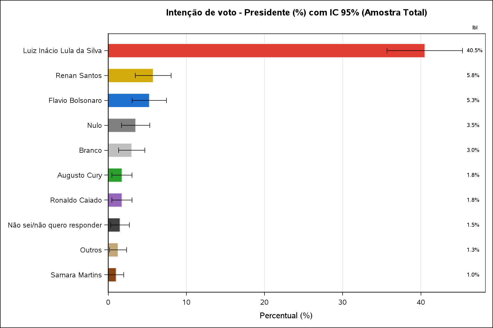
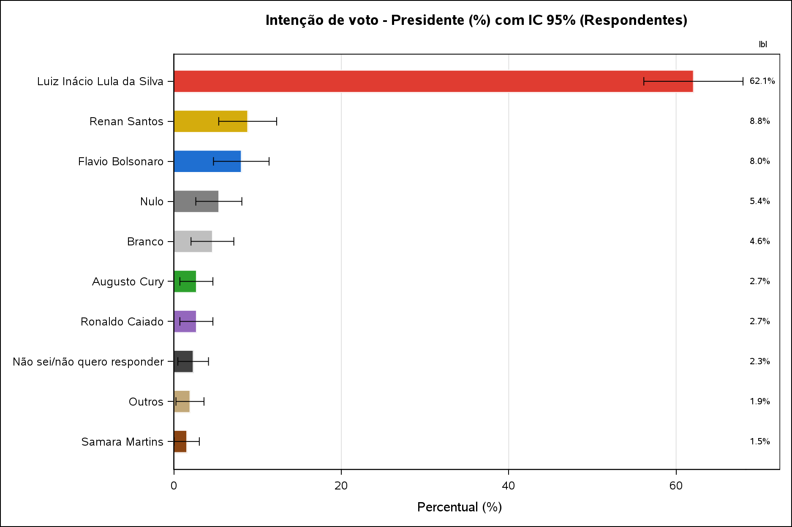
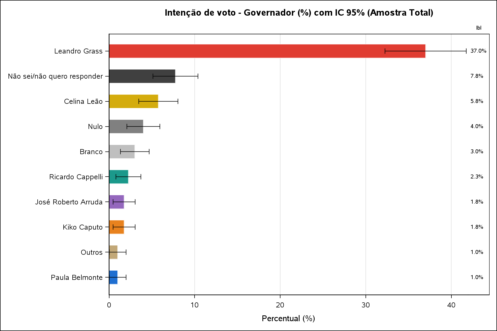

```{=latex}
\begin{titlepage}
\centering
\thispagestyle{empty}
\includegraphics[width=3cm]{imagens/unb/unb.png}\\[0.8cm]
{\large UNIVERSIDADE DE BRASÍLIA\\}
{\large INSTITUTO DE CIÊNCIAS EXATAS\\}
{\large DEPARTAMENTO DE ESTATÍSTICA\\}
{\large TÉCNICAS DE AMOSTRAGEM\\[2.5cm]}
{\Large\bfseries Pesquisa Eleitoral na UnB: Estimação da Intenção de Voto por Amostragem\\[0.4cm]}
{\large
Caroline Hernandes Amancio\\
Helio Ferreira de Carvalho\\
Karine Alves de Freitas Leite\\
Marcos Well Neres Silva Pereira\\
}
\vfill
{\large Brasília -- DF}\\
{\large 2026}
\end{titlepage}

\renewcommand{\contentsname}{Sumário}
\tableofcontents
\newpage

```

# Resumo

As pesquisas de opinião pública ocupam papel central nos processos democráticos, funcionando como mediadoras entre a vontade dos cidadãos e as elites políticas. Este trabalho tem como objetivo estimar a proporção de intenção de voto para os cargos de Presidente e Governador do Distrito Federal, a partir de uma amostra de 400 eleitores abordados presencialmente nos pavilhoes Anísio Teixeira e João Calmon, por meio de amostragem sistemática tratada como equivalente à Amostragem Aleatória Simples sem reposição. O tamanho de amostra (n=400) é justificado a partir da fórmula de dimensionamento amostral para uma margem de erro de 5 pontos percentuais. As estimativas pontuais, variâncias e intervalos de confiança foram obtidos via `PROC SURVEYFREQ` no software SAS, e o efeito da não-resposta (34,75% dos respondentes, classificados como não-respondentes totais pela combinação de quatro variáveis) sobre a margem de erro foi quantificado. O candidato Luiz Inácio Lula da Silva lidera a intenção de voto para Presidente (62,07%, IC 95%: \[56,14%; 67,99%\]) e Leandro Grass para Governador (56,70%, IC 95%: \[50,65%; 62,76%\]). A análise por subgrupos (sexo, turno, faixa etária e faixa de renda) indicou diferença estatisticamente significativa na intenção de voto principalmente em função da faixa etária (p\<0,0001 para os dois cargos); a associação com turno de coleta só foi significativa para Governador, a associação com sexo só foi significativa para Presidente, e a associação com faixa de renda não foi significativa para nenhum dos dois cargos.

**Palavras-chave:** amostragem, amostragem sistemática, pesquisa eleitoral, intervalo de confiança, margem de erro, não-resposta.

# 1. Introdução

As pesquisas eleitorais ocupam um papel de suma importancia nas democracias, funcionando como uma das principais ferramentas de mediação entre a vontade dos cidadãos e as elites políticas. Echegaray (2001) destaca que, desde os anos 1980, os levantamentos de opinião se tornaram centrais nos processos de consolidação democrática na América Latina, contribuindo para o aprimoramento da representação política e para a legitimidade dos resultados eleitorais. No entanto, o autor alerta para o risco de que esses instrumentos sejam manipulados por atores interessados em deslegitimar o próprio processo democrático. Desta forma, a condução adequada de uma pesquisa eleitoral, com um técnicas sólidas é fundamental cumpra essa função de subsidiar o debate público.

No Brasil, esse papel das pesquisas eleitorais ganha relevância em períodos de eleição, quando a intenção de voto da população se torna uma informação disputada tanto por campanhas políticas quanto pelo eleitorado, que a utiliza para acompanhar a corrida eleitoral e formar sua própria decisão de voto. Conhecer, com um nível de confiança estatístico adequado, a proporção de apoio a cada candidato antes do pleito permite não apenas orientar estratégias de campanha, mas também fornecer à sociedade um retrato mais fidedigno do cenário eleitoral do que impressões assistemáticas ou amostras de conveniência.

Em Brasília, esse cenário se expressa na disputa pelos cargos de Presidente da República e Governador do Distrito Federal, ambos decididos no mesmo pleito. Nesse contexto, conduziu-se uma pesquisa eleitoral presencial na cidade, com coleta de dados realizada junto a visitantes de pavilhões João Calmon e Anísio Teixeira, por meio de um plano amostral sistemático que buscou garantir representatividade ao longo de diferentes turnos do dia (manhã, tarde e noite).

Para tanto, foram abordadas 400 pessoas nos pavilhões Anísio Teixeira e João Calmon por meio de amostragem sistemática, com início aleatório sorteado entre a 1ª e a kª pessoa da sequência de chegada ao pavilhão. Em cada abordagem, registrou-se o sexo, a faixa etária, a faixa de renda familiar, o turno da coleta e a intenção de voto para Presidente e Governador, sendo os casos de recusa tratados como não-resposta.

## 1.1 Objetivos

O objetivo geral deste trabalho é estimar a proporção de intenção de voto para os cargos de Presidente e Governador do Distrito Federal, a partir de uma amostra probabilística de eleitores coletada em pavilhões de Brasília.

Os objetivos específicos são:

- calcular a margem de erro e o intervalo de confiança associados às estimativas de intenção de voto, com base no plano amostral adotado;
- justificar, por meio da fórmula de dimensionamento amostral, o tamanho de amostra (n=400) efetivamente utilizado na coleta;
- avaliar o efeito da não-resposta sobre a precisão das estimativas, incluindo a verificação de não-resposta diferencial entre grupos;
- verificar se há diferenças na intenção de voto entre subgrupos da amostra (turno de coleta, faixa etária e faixa de renda).

# 2. Referencial Teórico

A coleta de dados foi conduzida por meio de **amostragem sistemática**, utilizando um intervalo de seleção (K=k). Nesse procedimento, a cada (k) pessoas que passavam pelos pavilhões, uma era selecionada para participar da pesquisa. O processo teve início a partir de um ponto aleatório, definido por sorteio entre a 1ª e a (k)-ésima pessoa da sequência.

O ponto inicial de cada entrevistador foi determinado a partir dos números aleatórios fornecidos pelo professor no início da disciplina, conforme apresentado na tabela a seguir:

| Entrevistador | Número aleatório |
|:--------------|-----------------:|
| Caroline      |                1 |
| Helio         |                5 |
| Karine        |                8 |
| Marcos Well   |               10 |

Para fins de **estimação da variância e do erro-padrão**, a amostragem sistemática foi tratada como equivalente à **Amostragem Aleatória Simples sem reposição (AASs)**. Essa aproximação é adequada quando a população pode ser considerada em **ordem aleatória**, isto é, quando não há evidências de periodicidade, tendência ou outro padrão sistemático associado à variável de interesse, conforme destacam Cochran (1977) e Bolfarine e Bussab (2004).

## 2.1 Notação e parâmetros populacionais

Para uma população de tamanho $N$, com valores $Y_1,\dots,Y_N$, definem-se a média, o total e a variância populacionais (Cochran, 1977):

$$\bar{Y} = \frac{1}{N}\sum_{i=1}^{N} Y_i, \qquad \tau = \sum_{i=1}^{N} Y_i, \qquad S^2 = \frac{1}{N-1}\sum_{i=1}^{N}(Y_i-\bar{Y})^2$$

Para variáveis categóricas (como o candidato escolhido), define-se $Y_i=1$ se a unidade $i$ pertence à classe de interesse $C$ e $Y_i=0$ caso contrário, de modo que $\bar{Y}=P=A/N$ é a proporção populacional na classe $C$ (Cochran, 1977).

## 2.2 Estimador pontual e variância (AAS sem reposição)

Dentro do plano AASs, a proporção amostral $p=a/n$ (onde $a$ é o número de respondentes na classe $C$, dentre os $n$ válidos) é um estimador não viesado de $P$ (Cochran, 1977). Sua variância é:

$$Var(p) = \frac{S^2}{n}\left(\frac{N-n}{N}\right) = \frac{PQ}{n}\left(\frac{N-n}{N-1}\right), \qquad Q = 1-P$$

O fator $(N-n)/N = 1-f$, onde $f=n/N$ é a fração amostral (fpc) é aplicável quando $N$ é conhecido e finito. Quando a população é desconhecida ou muito grande em relação à amostra o fpc tende a 1 e a variância se reduz à forma usual:

$$Var(p) \approx \frac{p(1-p)}{n}$$

O estimador amostral não viesado dessa variância, substituindo $P,Q$ pelos valores amostrais $p,q=1-p$, é (Cochran, 1977):

$$var(p) = (1-f)\,\frac{p\,q}{n-1}$$

## 2.3 Erro-padrão e intervalo de confiança

O erro-padrão é $EP(p)=\sqrt{Var(p)}$. Assumindo normalidade assintótica de $p$ (Bolfarine & Bussab, 2004), o intervalo de confiança aproximado de coeficiente $1-\alpha$ para $P$ é (Cochran, 1977):

$$IC(P;\,1-\alpha) = p \pm Z_{\alpha/2}\sqrt{(1-f)\,\frac{p\,q}{n-1}}$$

onde $Z_{\alpha/2}$ é o percentil da Normal padrão para a confiança desejada (ex.: $Z=1{,}96$ para 95%). Para $N$ desconhecido/grande, $f\to 0$ e o intervalo se reduz a $p \pm Z_{\alpha/2}\sqrt{p(1-p)/n}$, forma empregada pela função `PROC SURVEYFREQ` do SAS.

## 2.4 Determinação do tamanho da amostra

Definida uma margem de erro tolerável $d$ e um risco $\alpha$ de que o erro real exceda $d$, isto é, $\Pr(|p-P|\geq d)=\alpha$, resolve-se para $n$ a partir da variância de $p$ (Cochran, 1977):

$$n = \dfrac{\dfrac{Z_{\alpha/2}^2\,PQ}{d^2}}{1+\dfrac{1}{N}\left(\dfrac{Z_{\alpha/2}^2\,PQ}{d^2}-1\right)}$$

Como $P$ raramente é conhecido a priori, usa-se uma estimativa prévia $p$ (ou o cenário de pior case $p=0{,}5$, que maximiza $PQ$). Para $N$ grande/desconhecido, a expressão se reduz à primeira aproximação (Cochran, 1977):

$$n_0 = \frac{Z_{\alpha/2}^2\,p(1-p)}{d^2}$$

Neste contexto, arredondamos $Z_{\alpha/2}\approx 2$ para o nível de confiança de 95% (em vez do valor exato $1{,}96$), o que simplifica a fórmula no cenário de pior caso ($p=0{,}5$, logo $p(1-p)=0{,}25$):

$$n_0 = \frac{2^2 \times 0{,}25}{d^2} = \frac{1}{d^2}$$

## 2.5 Amostragem sistemática

Considerando uma população com $N$ elementos ordenados de 1 a $N$, com $N=kn$ ($k$ inteiro). Uma unidade é sorteada aleatoriamente entre as $k$ primeiras unidades (número aleatório inicial $r\in\{1,\dots,k\}$), e as demais unidades da amostra são obtidas a intervalos regulares de comprimento $k$ (Cochran, 1977):

$$\text{elementos selecionados} = r,\ r+k,\ r+2k,\ \dots,\ r+(n-1)k$$

Neste trabalho, $k=K$. Cochran (1977) mostra que a amostragem sistemática equivale à seleção aleatória de **um único conglomerado** dentre $k$ conglomerados possíveis (cada um com $n$ unidades), de modo que sua variância verdadeira é:

$$V(\bar{y}_{sis}) = \frac{N-1}{N}S^2 - \frac{k(n-1)}{N}S^2_{wsy}$$

Quando a população está em ordem aleatória, a amostragem sistemática tem precisão próxima à da AAS, e sua variância pode ser estimada pelo mesmo estimador usado na AAS (Bolfarine & Bussab, 2004). Desta forma, adotamos a premissa de que a ordem de chegada das pessoas ao pavilhão seja não é cíclica ou correlacionada com a intenção de voto, de modo que se trata a variância da amostra sistemática como equivalente à da AASs.

# 3. Materiais e Métodos

Toda a análise estatística deste trabalho foi conduzida no **software SAS**, utilizando os procedimentos `PROC IMPORT` (leitura da base), `PROC FREQ` e `PROC SURVEYFREQ` (estimativas de proporção, variância e intervalo de confiança), `PROC SGPLOT` (gráficos) e `DATA` steps para tratamento da base e cálculos auxiliares. O script completo está disponível no arquivo `trabalho_amostragem.sas`.

## 3.1 Local e procedimento de coleta

A coleta foi realizada presencialmente nos pavilhões da Universidade de Brasília, por meio de abordagem direta aos visitantes. O plano amostral de campo adotado foi a *amostragem sistemática com* $K=k$, a cada $k$ pessoas que passavam pelo local, uma era selecionada para ser entrevistada, com início aleatório sorteado entre a 1ª e a $k$-ésima pessoa da sequência de chegada.

O valor de $k$ correspondia ao número aleatório associado a cada aluno entrevistador, sendo o procedimento realizado até que cada aluno completasse 100 entrevistas.

{width="70%"}

```{=latex}
\begin{center}
\begin{minipage}{0.48\textwidth}
\centering
\includegraphics[width=\textwidth,height=6.5cm,keepaspectratio]{imagens/imagens_coleta/coleta_1.jpeg}\\[2pt]
{\small Abordagem aos entrevistados --- turno diurno, área interna do pavilhão}
\end{minipage}
\hfill
\begin{minipage}{0.48\textwidth}
\centering
\includegraphics[width=\textwidth,height=6.5cm,keepaspectratio]{imagens/imagens_coleta/coleta_2.jpeg}\\[2pt]
{\small Abordagem aos entrevistados --- turno diurno, área externa do pavilhão}
\end{minipage}

\vspace{0.4cm}

\begin{minipage}{0.48\textwidth}
\centering
\includegraphics[width=\textwidth,height=6.5cm,keepaspectratio]{imagens/imagens_coleta/coleta_3.jpeg}\\[2pt]
{\small Abordagem aos entrevistados --- turno noturno}
\end{minipage}
\hfill
\begin{minipage}{0.48\textwidth}
\centering
\includegraphics[width=\textwidth,height=6.5cm,keepaspectratio]{imagens/imagens_coleta/coleta_4.jpeg}\\[2pt]
{\small Abordagem aos entrevistados --- turno noturno}
\end{minipage}
\end{center}
```

A coleta foi dividida em três turnos (Manhã, Tarde e Noite), cada um conduzido por um membro ou dupla da equipe, totalizando 400 registros válidos.

## 3.2 População de referência e correção de população finita (fpc)

Destacamos que os respondentes abordados nos pavilhões não constituem uma amostra probabilística de todo o eleitorado do Distrito Federal. Ainda assim, o tamanho desse eleitorado foi considerado para fundamentar, de forma explícita, a decisão de não aplicar a correção para população finita (fpc) nas estimativas de intenção de voto. Segundo o TRE-DF (julho de 2026), o Distrito Federal possui $N=2.562.037$ eleitores. Considerando o tamanho amostral de $n=261$, a fração amostral é dada por:

$$f = \frac{n}{N} \approx \frac{261}{2.562.037} \approx 0{,}0001018 \;(0{,}0102\%)$$

Consequentemente, o fator de correção para população finita é $fpc=\sqrt{1-f}\approx 0{,}99994$, indicando um efeito numérico desprezível sobre o erro-padrão das estimativas, sem impacto nos resultados apresentados. Esse valor de $N$ foi informado ao `PROC SURVEYFREQ` por meio da opção `TOTAL=`, permitindo verificar explicitamente que a correção para população finita é numericamente irrelevante neste caso, em vez de simplesmente presumir que a população é efetivamente infinita para fins de cálculo da variância.

```sas
%let N_DF = 2562037;  /* TRE-DF, julho/2026 */

proc surveyfreq data=amostra order=freq total=&N_DF.;
    tables presidente / var cl;
run;
```

Fonte: TRE-DF (2026). *Distrito Federal ultrapassa 2,56 milhões de eleitores e registra 94,4% do eleitorado apto com biometria*. Disponível em: <https://www.tre-df.jus.br/comunicacao/noticias/2026/Julho/distrito-federal-ultrapassa-2-56-milhoes-de-eleitores-e-registra-94-4-do-eleitorado-apto-com-biometria-1>.

## 3.3 Justificativa do tamanho da amostra (n = 400)

Embora os dados já estivessem integralmente coletados, o tamanho amostral de **n = 400** pessoas pode ser justificado teoricamente com base em uma margem de erro de $e=5\%$, conforme demonstrado a seguir. Para esse cálculo, utiliza-se a fórmula clássica de determinação do tamanho amostral para estimar uma proporção populacional:

$$n_0 = \frac{Z^2\,p(1-p)}{e^2} = \frac{2^2 \times 0{,}5 \times 0{,}5}{0{,}05^2} = \frac{1}{0{,}05^2} = \frac{1}{e^2} = 400$$

Nessa expressão, $Z$ representa o valor crítico associado ao nível de confiança desejado. Neste caso, adota-se $Z \approx 2$ como uma aproximação do valor crítico de $1{,}96$, correspondente ao nível de confiança de 95% em uma distribuição normal padrão. O parâmetro $p$ representa a proporção populacional esperada, sendo adotado $p=0{,}5$ por corresponder ao cenário de máxima variabilidade e, consequentemente, produzir o tamanho amostral mais conservador. Já $e=0{,}05$ representa a margem de erro absoluta de cinco pontos percentuais.

Assim, o valor de 400 entrevistas constitui uma referência teórica para o planejamento amostral, considerando os parâmetros convencionais de confiança e margem de erro.

```sas
data _null_;
    Z = 2;
    p = 0.5;
    e = 0.05;

    n0 = (Z**2 * p*(1-p)) / (e**2);   /* = 1/e² */

    put "n necessário (n0 = 1/e²): " n0 best6.;
run;
```

## 3.4 Tratamento da não-resposta

Quando um visitante era abordado e recusava participar da pesquisa ("Você quer/pode participar da pesquisa?" / "Não"), a recusa foi registrada deixando em branco as quatro perguntas mais sensíveis do formulário (Faixa etária, Faixa de renda, Presidente e Governador). Por isso, um respondente é classificado como não-respondente total quando essas quatro variáveis, em conjunto, indicam consistentemente ausência de engajamento: células em branco nas quatro, ou uma combinação de células em branco com as opções "Sem resposta" (perfil) e "Não sei/não quero responder" (voto) nas quatro ao mesmo tempo. Quando essa combinação é identificada, as quatro variáveis são tratadas como não-resposta (*missing*) para esse respondente:

```sas
data amostra;
    set amostra;
    ...
    if upcase(compbl(strip(presidente))) = 'NÃO SEI/NÃO QUERO RESPONDER' then
        presidente = 'Não sei/não quero responder';
    if upcase(compbl(strip(governador))) = 'NÃO SEI / NÃO QUERO RESPONDER' then
        governador = 'Não sei/não quero responder';

    status_respondente = 'Respondente';
    if faixa_etaria = 'Sem resposta' and faixa_renda = 'Sem resposta'
       and presidente = 'Não sei/não quero responder'
       and governador = 'Não sei/não quero responder' 
       then status_respondente = 'Não-respondente';
    else if missing(faixa_etaria) and missing(faixa_renda)
       and missing(presidente) and missing(governador) 
       then status_respondente = 'Não-respondente';
    
    if status_respondente = 'Não-respondente' then do;
        faixa_etaria = ''; faixa_renda = ''; presidente = ''; governador = '';
    end;
run;
```

Desta forma, identificaram-se 139 não-respondentes totais (34,75% de 400), ou seja, entrevistados que optaram por não responder as perguntas. Esse padrão foi classificado como recusa em participar da pesquisa, e esses casos foram excluídos das estimativas, que passam a se basear em 261 respondentes válidos (65,25%).

## 3.5 Consolidação de candidatos com menos de 1% dos votos na categoria "Outros"

Para simplificar a visualização dos resultados nos gráficos, criou-se a categoria "Outros", que reúne os candidatos cuja votação individual corresponde a menos de 1% dos votos válidos ($n=261$, após o desconto das não respostas).

- Presidente: Edmilson Costa (0,77%), Rui Costa Pimenta (0,38%), Hertz Dias (0,38%) e Romeu Zema (0,38%).
- Governador: Professor Robson (0,77%), Expedito Mendonça (0,38%) e Professora Samara Mineiro (0,38%).

As categorias Branco, Nulo e "Não sei/não quero responder" não foram incluídas nesse agrupamento, uma vez que não correspondem a candidatos. Além disso, suas proporções superam 1% em ambos os cargos, de modo que não atendem ao critério estabelecido para a consolidação.

Ressalta-se que esse agrupamento foi aplicado exclusivamente à apresentação gráfica. As tabelas de estimativas e os testes de qui-quadrado por subgrupo preservam a discriminação individual de cada candidato, sem perda de detalhamento nos resultados numéricos apresentados.

# 4. Análise dos Resultados

## 4.1 Perfil da amostra

Sexo e Turno foram observados para os 400 respondentes. Já Faixa etária e Faixa de renda só são conhecidas para os 261 respondentes não classificados como não-respondentes totais. Desta forma, essas duas variáveis são reportadas sobre a base de $n=261$, e não de $n=400$:

| Variável       | Categoria                      | Base    | \%     |
|----------------|---------------------------------|---------|--------|
| Sexo           | Masculino                      | n=400   | 51,00% |
| Sexo           | Feminino                       | n=400   | 49,00% |
| Faixa etária   | 19 a 24 anos                   | n=261   | 75,10% |
| Faixa etária   | Acima de 44 anos               | n=261   | 7,28%  |
| Faixa etária   | 25 a 29 anos                   | n=261   | 6,90%  |
| Faixa etária   | até 18 anos                    | n=261   | 6,13%  |
| Faixa etária   | 30 a 34 anos                   | n=261   | 1,92%  |
| Faixa etária   | 40 a 44 anos                   | n=261   | 1,15%  |
| Faixa etária   | Sem resposta (opção explícita) | n=261   | 0,77%  |
| Faixa etária   | 35 a 39 anos                   | n=261   | 0,77%  |
| Faixa de renda | R\$ 5.000 a R\$ 10.000         | n=261   | 25,67% |
| Faixa de renda | Mais de R\$ 10.000             | n=261   | 25,67% |
| Faixa de renda | R\$ 2.000 a R\$ 5.000          | n=261   | 24,52% |
| Faixa de renda | R\$ 1.000 a R\$ 2.000          | n=261   | 13,03% |
| Faixa de renda | Sem resposta (opção explícita) | n=261   | 9,20%  |
| Faixa de renda | até R\$ 1.000                  | n=261   | 1,92%  |
| Turno          | Manhã                          | n=400   | 78,25% |
| Turno          | Tarde                          | n=400   | 16,75% |
| Turno          | Noite                          | n=400   | 5,00%  |

A amostra apresentou equilíbrio entre sexos, mas concentrou-se de forma mais intensa no turno da manhã e na faixa etária de 19 a 24 anos: entre os 261 respondentes com faixa etária conhecida, 75,10% eram entre 19 e 24 anos, ou seja, uma concentração bem mais acentuada do que os 49,00% que se obteria calculando sobre os 400 respondentes nominais. Salientamos que este ponto foi abordado como uma limitação de representatividade (a amostra sistemática capturou majoritariamente um público jovem e do turno matutino, o que pode não refletir a composição etária real do eleitorado de Brasília).

{width="70%"}

{width="80%"}

{width="80%"}

{width="70%"}

## 4.2 Taxa de resposta

Como detalhado anteriormente, os não-respondentes totais foram tratados como não-resposta. Além disso, a taxa de resposta é de 65,25% (261 de 400) para Presidente e para Governador, a mesma de faixa etária e faixa de renda. Apenas sexo e turno, registrados pelo entrevistador, não apresentam não-resposta.

## 4.3 Estimativas pontuais, erro-padrão e IC 95% (PROC SURVEYFREQ, n válido = 261)

**Presidente:**

| Candidato                   | $\hat{p}$ (%) | Erro-padrão | IC 95%            |
|-----------------------------|---------------|-------------|-------------------|
| Luiz Inácio Lula da Silva   | 62,07         | 3,01        | \[56,14 ; 67,99\] |
| Renan Santos                | 8,81          | 1,76        | \[5,35 ; 12,27\]  |
| Flavio Bolsonaro            | 8,05          | 1,69        | \[4,72 ; 11,37\]  |
| Nulo                        | 5,36          | 1,40        | \[2,61 ; 8,12\]   |
| Branco                      | 4,60          | 1,30        | \[2,04 ; 7,16\]   |
| Ronaldo Caiado              | 2,68          | 1,00        | \[0,71 ; 4,65\]   |
| Augusto Cury                | 2,68          | 1,00        | \[0,71 ; 4,65\]   |
| Não sei/não quero responder | 2,30          | 0,93        | \[0,47 ; 4,13\]   |
| Samara Martins              | 1,53          | 0,76        | \[0,03 ; 3,03\]   |
| Edmilson Costa              | 0,77          | 0,54        | \[0,00 ; 1,83\]   |
| Rui Costa Pimenta           | 0,38          | 0,38        | \[0,00 ; 1,14\]   |
| Hertz Dias                  | 0,38          | 0,38        | \[0,00 ; 1,14\]   |
| Romeu Zema                  | 0,38          | 0,38        | \[0,00 ; 1,14\]   |

**Governador:**

| Candidato                   | $\hat{p}$ (%) | Erro-padrão | IC 95%            |
|-----------------------------|---------------|-------------|-------------------|
| Leandro Grass               | 56,70         | 3,07        | \[50,65 ; 62,76\] |
| Não sei/Não quero responder | 11,88         | 2,01        | \[7,93 ; 15,83\]  |
| Celina Leão                 | 8,81          | 1,76        | \[5,35 ; 12,27\]  |
| Nulo                        | 6,13          | 1,49        | \[3,20 ; 9,06\]   |
| Branco                      | 4,60          | 1,30        | \[2,04 ; 7,16\]   |
| Ricardo Cappelli            | 3,45          | 1,13        | \[1,22 ; 5,68\]   |
| José Roberto Arruda         | 2,68          | 1,00        | \[0,71 ; 4,65\]   |
| Kiko Caputo                 | 2,68          | 1,00        | \[0,71 ; 4,65\]   |
| Paula Belmonte              | 1,53          | 0,76        | \[0,03 ; 3,03\]   |
| Professor Robson            | 0,77          | 0,54        | \[0,00 ; 1,83\]   |
| Expedito Mendonça           | 0,38          | 0,38        | \[0,00 ; 1,14\]   |
| Professora Samara Mineiro   | 0,38          | 0,38        | \[0,00 ; 1,14\]   |

**Margem de erro nominal (n=400, p=0,5, nc = 95%, pior caso):** ±4,91 pontos percentuais\
**Margem de erro efetiva (n válido=261, descontando os 34,75% de não-resposta):** ±6,09 pontos percentuais

A não-resposta reduziu o n efetivo de 400 para 261, o que aumentou a margem de erro, de ±4,91 p.p. para ±6,09 p.p., resultando em um efeito real e substancial (1,18 p.p.), decorrente de uma taxa de não-resposta de 34,75%.

### 4.3.1 Demonstração do cálculo: efeito da não-resposta na margem de erro

Para a apuração da margem de erro utilizou-se o cenário de pior caso ($p=0,5$) para toda a amostra. Para tornar o efeito da não-resposta mais concreto, demonstra-se abaixo o cálculo completo para os dois candidatos mais votados, comparando o $n$ efetivamente observado (261, com a não-resposta de 34,75%) com um cenário hipotético em que a mesma proporção de votos tivesse sido obtida sobre os 400 respondentes nominais:

$$\text{var}(\hat p) = \frac{\hat p(1-\hat p)}{n-1} \qquad \text{se}(\hat p) = \sqrt{\text{var}(\hat p)} \qquad \text{margem} = t_{(0{,}975;\,n-1)} \times \text{se}(\hat p)$$

**Luiz Inácio Lula da Silva (Presidente):** $\hat p = 162/261 = 0,6207$ (62,07%)

| Cenário | $n$ | $\hat p(1-\hat p)$ | var($\hat p$) | se($\hat p$) | $t_{(0,975;\,n-1)}$ | Margem | IC 95% |
|---------|---------|---------|---------|---------|---------|---------|---------|
| Real (com não-resposta) | 261 | 0,6207 × 0,3793 = 0,2354 | 0,2354/260 = 0,000905 | 3,01% | 1,9691 | 5,93 p.p. | \[56,14% ; 67,99%\] |
| Hipotético (sem não-resposta) | 400 | 0,6207 × 0,3793 = 0,2354 | 0,2354/399 = 0,000590 | 2,43% | 1,9659 | 4,78 p.p. | \[57,29% ; 66,85%\] |

A margem de erro para Lula passou de ±4,78 p.p. (se não houvesse não-resposta) para ±5,93 p.p. (cenário real) — um aumento de 1,15 p.p., só pela redução do $n$ de 400 para 261 (a proporção $\hat p$ foi mantida fixa nos dois cálculos, isolando o efeito do tamanho da amostra sobre a precisão).

**Leandro Grass (Governador):** $\hat p = 148/261 = 0,5670$ (56,70%)

| Cenário | $n$ | $\hat p(1-\hat p)$ | var($\hat p$) | se($\hat p$) | $t_{(0,975;\,n-1)}$ | Margem | IC 95% |
|---------|---------|---------|---------|---------|---------|---------|---------|
| Real (com não-resposta) | 261 | 0,5670 × 0,4330 = 0,2455 | 0,2455/260 = 0,000944 | 3,07% | 1,9691 | 6,05 p.p. | \[50,65% ; 62,76%\] |
| Hipotético (sem não-resposta) | 400 | 0,5670 × 0,4330 = 0,2455 | 0,2455/399 = 0,000615 | 2,48% | 1,9659 | 4,88 p.p. | \[51,82% ; 61,58%\] |

Para Leandro Grass, a margem de erro passou de ±4,88 p.p. para ±6,05 p.p. — aumento de 1,17 p.p., na mesma linha do observado para Lula e do efeito genérico (p=0,5) já reportado acima. Em ambos os casos, a redução de $n$ causada pela não-resposta de 34,75% é responsável por todo o aumento, já que a proporção $\hat p$ foi mantida idêntica entre os dois cenários.

Os gráficos abaixo apresentam o intervalo de confiança de cada candidato em duas bases de cálculo: sobre a amostra total (n=400, em que os 139 não-respondentes aparecem implicitamente diluindo os percentuais) e sobre os 261 respondentes válidos (base usada na tabela acima e no restante deste relatório):

{width="85%"}

{width="85%"}

{width="85%"}

{width="85%"}


## 4.4 Análise por subgrupos (Sexo, Turno, Faixa Etária, Faixa de Renda)

Os testes qui-quadrado de associação entre o candidato escolhido e cada variável de perfil indicaram:

| Cruzamento | Qui-quadrado (GL) | p-valor |
|------------------|------------------|------------------|
| Presidente x Sexo | 28,25 (12) | 0,0051 |
| Governador x Sexo | 10,56 (11) | 0,4807 |
| Presidente x Faixa de Renda | 52,48 (60) | 0,7441 |
| Presidente x Faixa Etária | 167,76 (84) | \<0,0001 |
| Presidente x Turno | 26,18 (24) | 0,3439 |
| Governador x Faixa de Renda | 56,62 (55) | 0,4145 |
| Governador x Faixa Etária | 133,81 (77) | \<0,0001 |
| Governador x Turno | 38,90 (22) | 0,0145 |

- Sexo: Para Presidente, o teste qui-quadrado indicou associação estatisticamente significativa entre sexo e candidato escolhido (p=0,0051). Para Governador, não houve evidência de associação (p=0,4807).
- Faixa de renda: O cruzamento não é estatisticamente significativo para os dois cargos (Presidente p=0,7441; Governador p=0,4145). Ou seja, não há evidência, nesta amostra, de que a faixa de renda esteja associada ao candidato escolhido.
- Faixa etária: Fortemente significativa para os dois cargos (p\<0,0001), mas sofre de forte esparsidade, dado o grande número de categorias de candidatos combinado com faixas pouco povoadas.
- Turno: o resultado foi diferente entre os dois cargos. Para Governador, o teste qui-quadrado indicou diferença estatisticamente significativa na intenção de voto entre os turnos (p=0,0145). Para Presidente, não houve evidência de associação (p=0,3439).

{width="80%"}

{width="80%"}

{width="85%"}

{width="85%"}

{width="80%"}

{width="85%"}

{width="85%"}

{width="80%"}

# 5. Conclusões

A pesquisa eleitoral conduzida nos pavilhoes João Calmon e Anisio Teixeira em Brasília, com uma amostra de 400 eleitores coletados por amostragem sistemática (com intervalo $K$ próprio de cada entrevistador), permitiu estimar a intenção de voto para Presidente e Governador com margem de erro de aproximadamente ±4,91 pontos percentuais (nominal) e ±6,09 pontos percentuais (efetiva, considerando a não-resposta total de 34,75%).

O candidato à Presidência com maior intenção de voto foi Luiz Inácio Lula da Silva (62,07%, IC 95%: \[56,14%; 67,99%\]). Para Governador, o líder foi Leandro Grass (56,70%, IC 95%: \[50,65%; 62,76%\]), com uma parcela expressiva de indecisos ("Não sei/não quero responder", 11,88%).

A análise por subgrupos indicou que a faixa etária é a variável mais associada à intenção de voto para os dois cargos (p\<0,0001), enquanto faixa de renda não mostrou associação significativa para nenhum dos dois (Presidente p=0,7441; Governador p=0,4145). Para turno e para sexo, o resultado divergiu entre os cargos em direções opostas: turno foi significativo para Governador (p=0,0145) mas não para Presidente (p=0,3439); sexo foi significativo para Presidente (p=0,0051) mas não para Governador (p=0,4807). Mesmo os resultados significativos devem ser interpretados com cautela, já que a validade do teste é limitada pela baixa contagem esperada em boa parte das células (72% no cruzamento Governador x Turno, 62% em Presidente x Sexo), decorrente do pequeno número de entrevistas no turno da Noite (n=20) e de candidatos minoritários com poucos votos. Recomenda-se tratar esses achados como indícios a serem investigados, não como conclusões definitivas.

Como limitações do estudo, destacam-se: (i) a não-resposta total de 34,75% (139 de 400) que reduz consideravelmente o n efetivo e aumenta a margem de erro e (ii) a forte concentração da amostra na faixa etária de 19 a 24 anos (75,10% dos 261 respondentes com faixa etária conhecida), que limita a representatividade do levantamento em relação à distribuição etária real do eleitorado de Brasília.

Após a apuração do primeiro turno, os boletins de urna divulgados pelo TSE para o local de votação UnB permitiram uma comparação qualitativa com as estimativas deste trabalho: O candidato Luiz Inácio Lula da Silva obteve 68,70% dos votos válidos apurados nesse local (1.308 de 1.904), um resultado ligeiramente acima do intervalo de confiança estimado pela pesquisa (IC 95%: [56,14%; 67,99%]). Já o candidato Leandro Grass obteve 61,11% (990 de 1.620), dentro do intervalo estimado pela pesquisa (IC 95%: [50,65%; 62,76%]). Salientamos que trata-se apenas de uma comparação ilustrativa, não uma validação formal do IC, ou seja, o boletim cobre só um dos dois pavilhões pesquisados (não inclui o Anísio Teixeira) e reflete quem efetivamente compareceu às urnas nesse local no dia da eleição, não necessariamente o mesmo público abordado pela pesquisa em outro momento, mas reforça que a amostra, apesar das limitações apontadas, identificou corretamente os dois candidatos líderes em ambos os cargos.

# Referências {.unnumbered}

BOLFARINE, H.; BUSSAB, W. O. *Elementos de Amostragem*. São Paulo: Instituto de Matemática e Estatística, USP, 2004.

COCHRAN, W. G. *Sampling Techniques*. 3. ed. New York: John Wiley & Sons, 1977.

ECHEGARAY, F. O papel das pesquisas de opinião pública na consolidação da democracia: a experiência latino-americana. *Opinião Pública*, Campinas, v. 7, n. 1, 2001.

SILVA, A. R. da. Amostragem: Teoria e Aplicações. 1. ed. Brasília: Clube de Autores, 2025.

TSE. *Votação apurada por seção* — UnB, Pavilhão João Calmon, Zona 14, Brasília/DF, 1º turno, Eleição Geral Federal e Eleições Gerais Estaduais 2026. Apuração de 06/10/2026. Disponível em: <https://sig.tse.jus.br/ords/dwapr/r/seai/sig-eleicao-resultados/votacao-apurada-por-secao>.