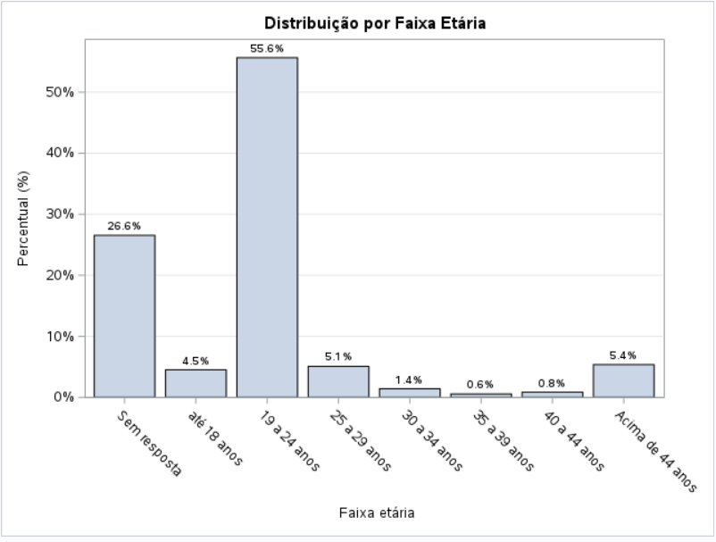
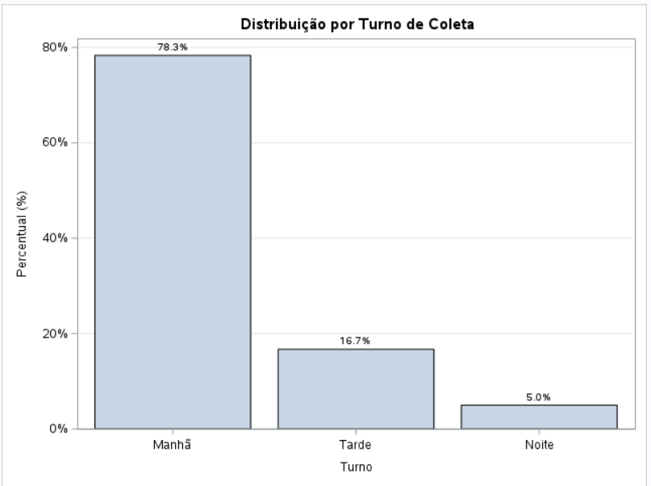
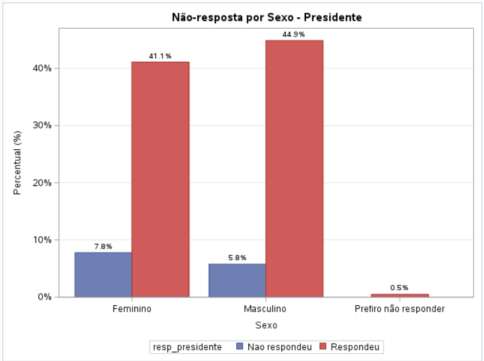
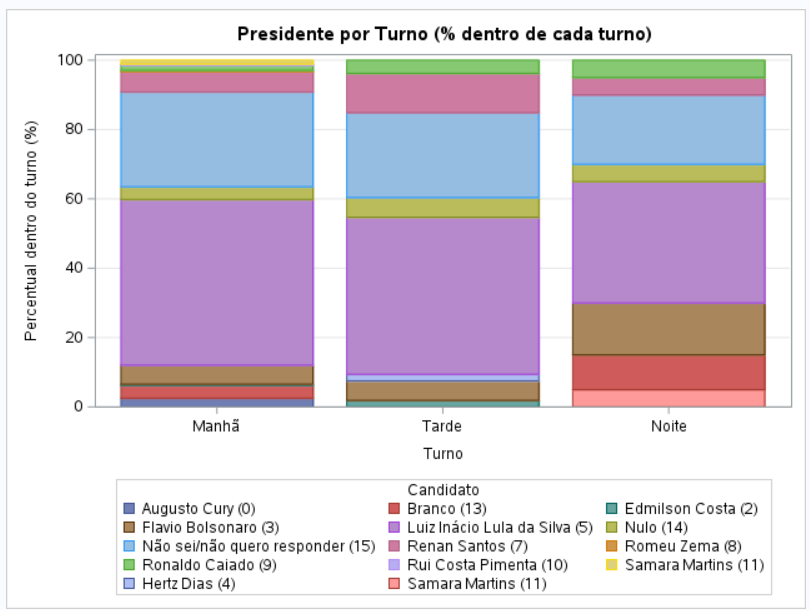
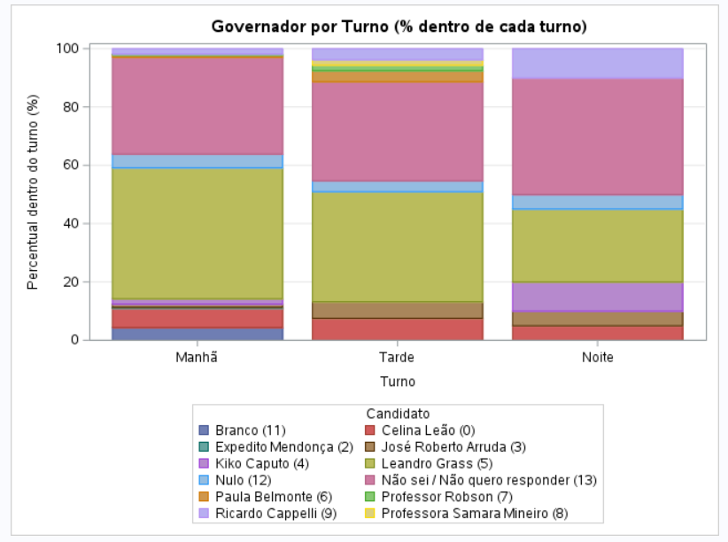

# Resumo

As pesquisas de opinião pública ocupam papel central nos processos democráticos, funcionando como mediadoras entre a vontade dos cidadãos e as elites políticas. Este trabalho tem como objetivo estimar a proporção de intenção de voto para os cargos de Presidente e Governador do Distrito Federal, a partir de uma amostra de 401 eleitores abordados presencialmente nos pavilhoes Anísio Teixeira e João Calmon, por meio de amostragem sistemática (K=2) tratada como equivalente à Amostragem Aleatória Simples sem reposição. O tamanho de amostra (n=400) é justificado a partir da fórmula de dimensionamento amostral para uma margem de erro de 5 pontos percentuais. As estimativas pontuais, variâncias e intervalos de confiança foram obtidos via `PROC SURVEYFREQ` no software SAS, e o efeito da não-resposta (13,47%) sobre a margem de erro foi quantificado. O candidato Luiz Inácio Lula da Silva lidera a intenção de voto para Presidente (46,69%, IC 95%: [41,41%; 51,96%]) e Leandro Grass para Governador (42,65%, IC 95%: [37,42%; 47,88%]). A análise por subgrupos (turno, faixa etária e faixa de renda) indicou diferenças na intenção de voto entre turnos de coleta, embora com ressalvas quanto à validade do teste qui-quadrado dado o pequeno número de observações em algumas células.

**Palavras-chave:** amostragem, amostragem sistemática, pesquisa eleitoral, intervalo de confiança, margem de erro, não-resposta.

# 1. Introdução

As pesquisas de opinião pública ocupam um papel central nos processos democráticos contemporâneos, funcionando como um dos principais mecanismos de mediação entre a vontade dos cidadãos e as elites políticas. Echegaray (2001) destaca que, desde os anos 1980, os levantamentos de opinião se tornaram centrais nos processos de consolidação democrática na América Latina, contribuindo para o aprimoramento da representação política e para a legitimidade dos resultados eleitorais. No entanto, o autor alerta para o risco de que esses instrumentos sejam manipulados por atores interessados em deslegitimar o próprio processo democrático. Desta forma, a condução tecnicamente rigorosa de uma pesquisa eleitoral, com um técnicas sólidas e a quantificação explícita de sua margem de erro, é condição necessária para que ela efetivamente cumpra essa função de informar o debate público.

No Brasil, esse papel das pesquisas eleitorais ganha relevância em períodos de eleição, quando a intenção de voto da população se torna uma informação disputada tanto por campanhas políticas quanto pelo eleitorado, que a utiliza para acompanhar a corrida eleitoral e formar sua própria decisão de voto. Conhecer, com um nível de confiança estatístico adequado, a proporção de apoio a cada candidato antes do pleito permite não apenas orientar estratégias de campanha, mas também fornecer à sociedade um retrato mais fidedigno do cenário eleitoral do que impressões assistemáticas ou amostras de conveniência.

Em Brasília, esse cenário se expressa na disputa pelos cargos de Presidente da República e Governador do Distrito Federal, ambos decididos no mesmo pleito. Nesse contexto, conduziu-se uma pesquisa eleitoral presencial na cidade, com coleta de dados realizada junto a visitantes de pavilhões João Calmon e Anísio Teixeira, por meio de um plano amostral sistemático que buscou garantir representatividade ao longo de diferentes turnos do dia (manhã, tarde e noite).

Para tanto, foram abordadas 400 pessoas nos pavilhões Anísio Teixeira e João Calmon por meio de amostragem sistemática (K=2), com início aleatório sorteado entre a 1ª e a 2ª pessoa da sequência de chegada ao pavilhão. Em cada abordagem, registrou-se o sexo, a faixa etária, a faixa de renda familiar, o turno da coleta e a intenção de voto para Presidente e Governador, sendo os casos de recusa tratados como não-resposta.

## 1.1 Objetivos

O objetivo geral deste trabalho é estimar a proporção de intenção de voto para os cargos de Presidente e Governador do Distrito Federal, a partir de uma amostra probabilística de eleitores coletada em pavilhões de Brasília.

Os objetivos específicos são:

- calcular a margem de erro e o intervalo de confiança associados às estimativas de intenção de voto, com base no plano amostral adotado;
- justificar, por meio da fórmula de dimensionamento amostral, o tamanho de amostra (n=400) efetivamente utilizado na coleta;
- avaliar o efeito da não-resposta sobre a precisão das estimativas, incluindo a verificação de não-resposta diferencial entre grupos;
- verificar se há diferenças na intenção de voto entre subgrupos da amostra (turno de coleta, faixa etária e faixa de renda).

# 2. Referencial Teórico

A coleta foi conduzida por **amostragem sistemática**, com intervalo $K=2$: a cada 2 pessoas que passavam pelos pavilhões, 1 era abordada, com início aleatório sorteado entre a 1ª e a 2ª pessoa da sequência. Para fins de estimação de variância e erro-padrão, a amostragem sistemática foi tratada de forma equivalente à Amostragem Aleatória Simples sem reposição (AASs) — prática padrão quando a população está em "ordem aleatória" (ausência de periodicidade ou tendência), como justificado por Cochran (1977) e Bolfarine & Bussab (2004).

## 2.1 Notação e parâmetros populacionais

Para uma população de tamanho $N$, com valores $Y_1,\dots,Y_N$, definem-se a média, o total e a variância populacionais (Cochran, 1977, Eq. 2.6–2.7; Bolfarine & Bussab, 2004, Cap. 2):

$$\bar{Y} = \frac{1}{N}\sum_{i=1}^{N} Y_i, \qquad \tau = \sum_{i=1}^{N} Y_i, \qquad S^2 = \frac{1}{N-1}\sum_{i=1}^{N}(Y_i-\bar{Y})^2$$

Para variáveis categóricas (como o candidato escolhido), define-se $Y_i=1$ se a unidade $i$ pertence à classe de interesse $C$ e $Y_i=0$ caso contrário, de modo que $\bar{Y}=P=A/N$ é a proporção populacional na classe $C$ (Cochran, 1977, Cap. 3, Eq. 3.1–3.2).

## 2.2 Estimador pontual e variância (AAS sem reposição)

Dentro do plano AASs, a proporção amostral $p=a/n$ (onde $a$ é o número de respondentes na classe $C$, dentre os $n$ válidos) é um estimador não viesado de $P$ (Cochran, 1977, Teorema 3.1; Bolfarine & Bussab, 2004, Corolário 3.4). Sua variância é:

$$Var(p) = \frac{S^2}{n}\left(\frac{N-n}{N}\right) = \frac{PQ}{n}\left(\frac{N-n}{N-1}\right), \qquad Q = 1-P$$

(Cochran, 1977, Teorema 2.2 e Eq. 3.6; Bolfarine & Bussab, 2004, Eq. 3.30). O fator $(N-n)/N = 1-f$, onde $f=n/N$ é a fração amostral, é chamado **correção de população finita** (*fpc*) — ele só é aplicável quando $N$ é conhecido e finito. Quando a população é desconhecida ou muito grande em relação à amostra (caso deste trabalho, em que a população de eleitores é muito maior que $n=400$), o fpc tende a 1 e a variância se reduz à forma usual:

$$Var(p) \approx \frac{p(1-p)}{n}$$

O estimador amostral não viesado dessa variância, substituindo $P,Q$ pelos valores amostrais $p,q=1-p$, é (Cochran, 1977, Eq. 3.8; Bolfarine & Bussab, 2004, Eq. 3.31–3.32 com divisor $n-1$):

$$var(p) = (1-f)\,\frac{p\,q}{n-1}$$

## 2.3 Erro-padrão e intervalo de confiança

O erro-padrão é $EP(p)=\sqrt{Var(p)}$. Assumindo normalidade assintótica de $p$ (válida para $n$ suficientemente grande, Bolfarine & Bussab, 2004, Seção 3.3.4), o intervalo de confiança aproximado de coeficiente $1-\alpha$ para $P$ é (Cochran, 1977, Eq. 2.23; Bolfarine & Bussab, 2004, Eq. 3.32):

$$IC(P;\,1-\alpha) = p \pm Z_{\alpha/2}\sqrt{(1-f)\,\frac{p\,q}{n-1}}$$

onde $Z_{\alpha/2}$ é o percentil da Normal padrão para a confiança desejada (ex.: $Z=1{,}96$ para 95%). Para $N$ desconhecido/grande, $f\to 0$ e o intervalo se reduz a $p \pm Z_{\alpha/2}\sqrt{p(1-p)/n}$, forma empregada pelo `PROC SURVEYFREQ` do SAS neste trabalho.

## 2.4 Determinação do tamanho da amostra

Fixada uma margem de erro tolerável $d$ e um risco $\alpha$ de que o erro real exceda $d$, isto é, $\Pr(|p-P|\geq d)=\alpha$, resolve-se para $n$ a partir da variância de $p$ (Cochran, 1977, Seção 4.4, Eq. 4.1):

$$n = \dfrac{\dfrac{Z_{\alpha/2}^2\,PQ}{d^2}}{1+\dfrac{1}{N}\left(\dfrac{Z_{\alpha/2}^2\,PQ}{d^2}-1\right)}$$

Como $P$ raramente é conhecido a priori, usa-se uma estimativa prévia $p$ (ou o cenário de pior caso $p=0{,}5$, que maximiza $PQ$). Para $N$ grande/desconhecido, a expressão se reduz à primeira aproximação (Cochran, 1977, Eq. 4.2; Bolfarine & Bussab, 2004, Eq. 3.29 com $D=B^2/z_\alpha^2$):

$$n_0 = \frac{Z_{\alpha/2}^2\,p(1-p)}{d^2}$$

Na prática, é comum arredondar $Z_{\alpha/2}\approx 2$ para o nível de confiança de 95% (em vez do valor exato $1{,}96$), o que simplifica a fórmula no cenário de pior caso ($p=0{,}5$, logo $p(1-p)=0{,}25$):

$$n_0 = \frac{2^2 \times 0{,}25}{d^2} = \frac{1}{d^2}$$

Essa é a fórmula usada na Seção 3.2 deste relatório para justificar o $n=400$ efetivamente coletado.

## 2.5 Amostragem sistemática

Considerando uma população com $N$ elementos ordenados de 1 a $N$, com $N=kn$ ($k$ inteiro). Uma unidade é sorteada aleatoriamente entre as $k$ primeiras unidades (número aleatório inicial $r\in\{1,\dots,k\}$), e as demais unidades da amostra são obtidas a intervalos regulares de comprimento $k$ (Cochran, 1977, Cap. 8, Seção 8.1; Bolfarine & Bussab, 2004, Seção 7.8):

$$\text{elementos selecionados} = r,\ r+k,\ r+2k,\ \dots,\ r+(n-1)k$$

Neste trabalho, $k=K=2$. Cochran (1977, Seção 8.2) mostra que a amostragem sistemática equivale à seleção aleatória de **um único conglomerado** dentre $k$ conglomerados possíveis (cada um com $n$ unidades), de modo que sua variância verdadeira é:

$$V(\bar{y}_{sis}) = \frac{N-1}{N}S^2 - \frac{k(n-1)}{N}S^2_{wsy}$$

(Cochran, 1977, Teorema 8.1; equivalentemente, Bolfarine & Bussab, 2004, Eq. 7.6–7.8, em termos do coeficiente de correlação intraclasse $\rho_{int}$: $V_k=\{1+\rho_{int}(n-1)\}\,\sigma^2/n$). Quando a população está em ordem aleatória (sem tendência ou periodicidade), a amostragem sistemática tem precisão próxima à da AAS, e sua variância pode ser estimada pelo mesmo estimador usado na AAS (Bolfarine & Bussab, 2004, Eq. 7.7; Corolário 3.5). É essa a aproximação adotada neste trabalho: não há motivo para supor que a ordem de chegada das pessoas ao pavilhão seja cíclica ou correlacionada com a intenção de voto, de modo que se trata a variância da amostra sistemática ($K=2$) como equivalente à da AASs.

# 3. Materiais e Métodos

Toda a análise estatística deste trabalho foi conduzida no **software SAS**, utilizando os procedimentos `PROC IMPORT` (leitura da base), `PROC FREQ` e `PROC SURVEYFREQ` (estimativas de proporção, variância e intervalo de confiança), `PROC SGPLOT` (gráficos) e `DATA` steps para tratamento da base e cálculos auxiliares. O script completo está disponível no arquivo `trabalho_amostragem.sas`.

## 3.1 Local e procedimento de coleta

A coleta foi realizada presencialmente em pavilhões na cidade de Brasília, por meio de abordagem direta aos visitantes. O plano amostral de campo foi a **amostragem sistemática com $K=2$**: a cada 2 pessoas que passavam pelo local, 1 era selecionada para ser entrevistada, com início aleatório sorteado entre a 1ª e a 2ª pessoa da sequência de chegada.

A coleta foi dividida em três turnos (Manhã, Tarde e Noite), cada um conduzido por um membro/subgrupo da equipe. Antes da análise, foram descartadas 18 linhas totalmente vazias ao final da planilha (artefato da ferramenta de coleta), restando 401 registros válidos:

```sas
data amostra;
    set amostra;
    if missing(Timestamp) then delete;   /* descarta linhas vazias (artefato) */
    id = _n_;
run;
```

## 3.2 Justificativa do tamanho da amostra (n = 400)

Embora os dados já estivessem integralmente coletados, o tamanho de amostra de **n = 400** pessoas pode ser justificado "por engenharia reversa", a partir da margem de erro $e=5\%$ admitida, com confiança de aproximadamente 95% ($Z\approx2$) e cenário de pior caso ($p=0{,}5$, que maximiza a variância):

$$n_0 = \frac{Z^2\,p(1-p)}{e^2} = \frac{2^2 \times 0{,}5 \times 0{,}5}{0{,}05^2} = \frac{1}{0{,}05^2} = \frac{1}{e^2} = 400$$

O resultado bate **exatamente** com o $n=400$ efetivamente coletado — confirmando que o plano amostral foi dimensionado para uma margem de erro de 5 pontos percentuais, com 95% de confiança, seguindo a regra prática $n_0=1/e^2$ usual em pesquisas eleitorais no Brasil. Esse cálculo foi implementado no SAS como:

```sas
data _null_;
    Z = 2;         /* aproximação usual para 95% de confiança */
    p = 0.5;       /* cenário de pior caso (variância máxima) */
    e = 0.05;      /* margem de erro admitida: 5 pontos percentuais */

    n0 = (Z**2 * p*(1-p)) / (e**2);   /* = 1/e² */

    put "n necessário (n0 = 1/e²): " n0 best6.;
run;
```

## 3.3 Tratamento da não-resposta

Quando um visitante era abordado e recusava participar da pesquisa ("Você quer fazer a pesquisa?" / "Não"), a resposta era registrada como ausente (*missing*) nas variáveis de intenção de voto, e o ocorrido era documentado fotograficamente em campo. No tratamento estatístico, essas observações ausentes foram excluídas do cálculo das proporções e intervalos de confiança (consistente com a prática de `PROC SURVEYFREQ`/`PROC FREQ` do SAS, que desconsideram valores ausentes automaticamente), mas foram quantificadas separadamente para avaliar o impacto da não-resposta sobre o erro-padrão das estimativas (ver Seção 4.3):

```sas
data amostra;
    set amostra;
    resp_presidente = ifc(missing(presidente), 'Nao respondeu', 'Respondeu');
    resp_governador = ifc(missing(governador), 'Nao respondeu', 'Respondeu');
run;

proc surveyfreq data=amostra;
    tables presidente / cl;
run;
```

# 4. Análise dos Resultados

## 4.1 Perfil da amostra

Dos 401 respondentes válidos, o perfil demográfico foi:

| Variável | Categoria | % |
|---|---|---|
| Sexo | Masculino | 50,63% |
| Sexo | Feminino | 48,87% |
| Sexo | Prefiro não responder | 0,50% |
| Faixa etária | 19 a 24 anos | 55,65% |
| Faixa etária | Sem resposta (opção explícita) | 26,55% |
| Faixa etária | Acima de 44 anos | 5,37% |
| Faixa etária | 25 a 29 anos | 5,08% |
| Faixa etária | até 18 anos | 4,52% |
| Faixa etária | 30 a 34 anos | 1,41% |
| Faixa etária | 40 a 44 anos | 0,85% |
| Faixa etária | 35 a 39 anos | 0,56% |
| Faixa de renda | Sem resposta (opção explícita) | 31,61% |
| Faixa de renda | Mais de R\$ 10.000 | 19,25% |
| Faixa de renda | R\$ 5.000 a R\$ 10.000 | 19,25% |
| Faixa de renda | R\$ 2.000 a R\$ 5.000 | 18,68% |
| Faixa de renda | R\$ 1.000 a R\$ 2.000 | 9,77% |
| Faixa de renda | até R\$ 1.000 | 1,44% |
| Turno | Manhã | 78,30% |
| Turno | Tarde | 16,71% |
| Turno | Noite | 4,99% |

A amostra é equilibrada entre sexos, mas fortemente concentrada na faixa etária de 19 a 24 anos e no turno da manhã — isso deve ser mencionado como uma limitação de representatividade (a amostra sistemática capturou majoritariamente um público jovem e do turno matutino, o que pode não refletir a composição etária real do eleitorado de Brasília).

{width=80%}

{width=80%}

## 4.2 Não-resposta

- Taxa de não-resposta - Presidente: **13,47%** (54 de 401)
- Taxa de não-resposta - Governador: **13,47%** (54 de 401) — os mesmos 54 respondentes não responderam a nenhuma das duas perguntas, sugerindo recusa geral em participar, e não dúvida específica sobre um cargo.
- Não-resposta diferencial por sexo: mulheres tiveram taxa de não-resposta de **15,90%**, contra **11,39%** dos homens. A diferença é pequena, mas consistente nas duas perguntas — pode ser mencionada como um indício (não conclusivo) de viés leve de não-resposta por sexo.

{width=55%}

## 4.3 Estimativas pontuais, erro-padrão e IC 95% (PROC SURVEYFREQ, n válido = 347)

**Presidente:**

| Candidato | $\hat{p}$ (%) | Erro-padrão | IC 95% |
|---|---|---|---|
| Luiz Inácio Lula da Silva (5) | 46,69 | 2,68 | [41,41 ; 51,96] |
| Não sei/não quero responder (15) | 26,51 | 2,37 | [21,85 ; 31,18] |
| Renan Santos (7) | 6,62 | 1,34 | [3,99 ; 9,26] |
| Flavio Bolsonaro (3) | 6,05 | 1,28 | [3,53 ; 8,57] |
| Branco (13) | 3,46 | 0,98 | [1,53 ; 5,39] |
| Nulo (14) | 4,03 | 1,06 | [1,95 ; 6,12] |
| Augusto Cury (0) | 2,02 | 0,76 | [0,53 ; 3,50] |
| Ronaldo Caiado (9) | 2,02 | 0,76 | [0,53 ; 3,50] |
| Edmilson Costa (2) | 0,58 | 0,41 | [0,00 ; 1,38] |
| Hertz Dias (4) | 0,29 | 0,29 | [0,00 ; 0,86] |
| Romeu Zema (8) | 0,29 | 0,29 | [0,00 ; 0,86] |
| Rui Costa Pimenta (10) | 0,29 | 0,29 | [0,00 ; 0,86] |
| Samara Martins (11)\* | 0,29 + 0,86 | — | — |

*\* O candidato "Samara Martins (11)" aparece **duas vezes** na base com grafias ligeiramente diferentes (uma com espaço em branco antes do nome), por erro de digitação no instrumento de coleta — recomenda-se consolidar as duas entradas antes da análise final (limitação de qualidade de dados).*

**Governador:**

| Candidato | $\hat{p}$ (%) | Erro-padrão | IC 95% |
|---|---|---|---|
| Leandro Grass (5) | 42,65 | 2,66 | [37,42 ; 47,88] |
| Não sei/Não quero responder (13) | 33,72 | 2,54 | [28,72 ; 38,72] |
| Celina Leão (0) | 6,63 | 1,34 | [4,00 ; 9,26] |
| Branco (11) | 3,46 | 0,98 | [1,53 ; 5,39] |
| Nulo (12) | 4,61 | 1,13 | [2,39 ; 6,83] |
| Ricardo Cappelli (9) | 2,59 | 0,85 | [0,91 ; 4,27] |
| José Roberto Arruda (3) | 2,02 | 0,76 | [0,53 ; 3,50] |
| Kiko Caputo (4) | 2,02 | 0,76 | [0,53 ; 3,50] |
| Paula Belmonte (6) | 1,15 | 0,57 | [0,02 ; 2,28] |
| Professor Robson (7) | 0,58 | 0,41 | [0,00 ; 1,38] |
| Professora Samara Mineiro (8) | 0,29 | 0,29 | [0,00 ; 0,86] |
| Expedito Mendonça (2) | 0,29 | 0,29 | [0,00 ; 0,86] |

**Margem de erro nominal (n=400, p=0,5, pior caso):** ±4,9 pontos percentuais\
**Margem de erro efetiva (n válido=347, descontando os 13,47% de não-resposta):** ±5,26 pontos percentuais

> A não-resposta reduziu o n efetivo de 400 para 347, o que **aumentou** a margem de erro de ±4,9 p.p. para ±5,26 p.p. — um efeito real, embora modesto, da não-resposta sobre a precisão das estimativas.

## 4.4 Análise por subgrupos (Turno, Faixa Etária, Faixa de Renda)

Os testes qui-quadrado de associação entre o candidato escolhido e cada variável de perfil indicaram:

| Cruzamento | Qui-quadrado (GL) | p-valor | Observação |
|---|---|---|---|
| Presidente x Faixa de Renda | 284,59 (65) | <0,0001 | 86% das células com contagem esperada <5 — teste pode não ser válido |
| Presidente x Faixa Etária | 494,49 (91) | <0,0001 | 88% das células com contagem esperada <5 — teste pode não ser válido |
| Presidente x Turno | 40,01 (26) | **0,0389** | 71% das células com contagem esperada <5 — teste pode não ser válido |
| Governador x Faixa de Renda | 225,10 (55) | <0,0001 | 83% das células com contagem esperada <5 — teste pode não ser válido |
| Governador x Faixa Etária | 382,20 (77) | <0,0001 | 84% das células com contagem esperada <5 — teste pode não ser válido |
| Governador x Turno | 35,42 (22) | **0,0350** | 67% das células com contagem esperada <5 — teste pode não ser válido |

- **Turno:** o teste qui-quadrado sugere uma diferença estatisticamente significativa na intenção de voto entre os turnos (p=0,0389 para Presidente; p=0,0350 para Governador). Olhando os gráficos de barras empilhadas, a maior diferença aparece no turno da Noite, com uma participação bem maior de "Branco/Flávio Bolsonaro" em Presidente e mais "Não sei/Não quero responder" proporcionalmente menor. **Importante:** o próprio SAS alerta que mais de 2/3 das células têm contagem esperada menor que 5 (reflexo do turno Noite ter apenas 20 respondentes e dos candidatos minoritários terem poucas respostas) — isso torna o teste qui-quadrado estatisticamente pouco confiável nesse cruzamento, e deve ser mencionado como limitação ao relatar esse resultado, não como conclusão definitiva.
- **Faixa etária** e **Faixa de renda:** ambos os cruzamentos são fortemente significativos (p<0,0001), mas sofrem do mesmo problema de esparsidade (84%–88% das células com contagem esperada <5), dado o grande número de categorias de candidatos combinado com faixas pouco povoadas (ex: 35 a 39 anos tem apenas 5 respondentes no total). A leitura qualitativa dos gráficos é mais confiável que o p-valor nesse caso.

{width=80%}

{width=80%}

# 5. Conclusões

A pesquisa eleitoral conduzida em Brasília, com uma amostra de 401 eleitores coletados por amostragem sistemática (K=2) a partir de uma meta de n=400, permitiu estimar a intenção de voto para Presidente e Governador com margem de erro de aproximadamente ±4,9 pontos percentuais (nominal) e ±5,26 pontos percentuais (efetiva, considerando a não-resposta de 13,47%).

O candidato à Presidência com maior intenção de voto foi **Luiz Inácio Lula da Silva** (46,69%, IC 95%: [41,41%; 51,96%]), seguido por uma parcela expressiva de indecisos/recusas ("Não sei/não quero responder", 26,51%). Para Governador, o líder foi **Leandro Grass** (42,65%, IC 95%: [37,42%; 47,88%]), também com grande parcela de indecisos (33,72%).

A análise por subgrupos indicou diferença estatisticamente significativa na intenção de voto entre os turnos de coleta (p=0,0389 e p=0,0350), o que é um ponto de discussão conforme antecipado no planejamento do trabalho — mas a validade desse teste é limitada pela baixa contagem esperada em boa parte das células (71% e 67% das células, respectivamente), decorrente do pequeno número de entrevistas no turno da Noite (n=20). Recomenda-se tratar esse achado como indício a ser investigado, não como conclusão definitiva.

Como limitações do estudo, destacam-se: (i) a não-resposta de 13,47% nas perguntas de intenção de voto, que reduz o tamanho efetivo da amostra e aumenta a margem de erro das estimativas; (ii) a suposição de tratar o plano sistemático (K=2) como equivalente à AAS para fins de cálculo de variância, válida apenas na ausência de periodicidade na ordem de chegada dos entrevistados; (iii) a forte concentração da amostra no turno da manhã (78,3%) e na faixa etária de 19 a 24 anos (55,65%), que limita a representatividade do levantamento em relação ao eleitorado geral da cidade; e (iv) uma inconsistência de digitação identificada na base (candidato "Samara Martins" registrado sob duas grafias distintas), que deveria ser corrigida em uma versão revisada da análise.

# Referências {.unnumbered}

BOLFARINE, H.; BUSSAB, W. O. *Elementos de Amostragem*. São Paulo: Instituto de Matemática e Estatística, USP, 2004.

COCHRAN, W. G. *Sampling Techniques*. 3. ed. New York: John Wiley & Sons, 1977.

ECHEGARAY, F. O papel das pesquisas de opinião pública na consolidação da democracia: a experiência latino-americana. *Opinião Pública*, Campinas, v. 7, n. 1, 2001.
